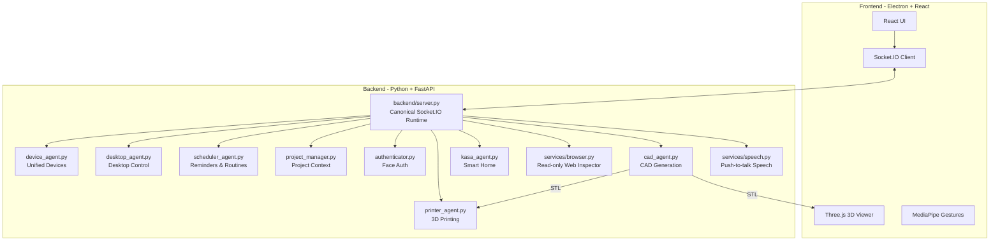

```
    _    _    ___ __   __ ___  ___
 _ | |  /_\  | _ \\ \ / /|_ _|/ __|
| || | / _ \ |   / \ V /  | | \__ \
 \__/ /_/ \_\|_|_\  \_/  |___||___/
Your personal assistant for desktop and phone
```


> Renamed from INARA on 5 Nov 2026; data and settings migrate automatically.

> Your own AI that lives on your desktop, controls your house, designs your parts, runs your browser, and prints your prototypes - all by voice.

> Supported Windows runtime: `backend/resident_main.py` hosts the tray and `backend/server.py` core. `electron/native-main.cjs` runs the workspace on demand. The `backend/core/` server refactor is archived reference code.

## Current source milestone

[Usage & quality](docs/USAGE_AND_QUALITY.md) now provides explicit owner-wide cloud authorization allowances, provider token/local-job receipts and 12 isolated offline contract evaluations. It defaults to monitor only; invoice cost and real model quality remain unverified.

[Project memory](docs/PROJECT_MEMORY.md) now adds explicit local facts/preferences/decisions, search, consent-controlled assistant context, expiry/forget and protected same-profile backup/recovery. Open it from Command quick launch or the command palette.

R1-R8 source/fixture milestones are implemented, including the read-only selected-notification desktop inbox and gated Android source. Android compilation/device acceptance, configured heavy capabilities and signed standalone distribution remain pending. [Current handoff](docs/IMPLEMENTATION_HANDOFF.md), [R8 evidence](docs/R8_NOTIFICATIONS.md), [release gates and backlog](docs/RELEASE_READINESS.md). No WhatsApp replies or calls were enabled.

## Revival: durable assistant and command deck

Typed chat now runs independently of the microphone and Gemini Live audio session.
The backend boots with the lean core dependencies and loads optional capabilities
only when requested. Projects and typed sessions survive restart, and reminders use
transactional delivery with receipt and completion. Private payloads are protected
with Windows DPAPI before SQLite writes; see [persistence and recovery](docs/PERSISTENCE.md).

Supported toolchain on Windows: **Python 3.12** (3.13 works for development, but
packaging and some runtime tests are pinned to 3.12) and **Node.js 24 LTS**
(`.nvmrc`; 22.12+ works with the npm scripts, which pass the needed flags below 22.18).
`bootstrap.ps1` creates the venv with `py -3.12` when the Python launcher has it, warns
on any other Python version, and stops on Node.js older than 22.12.

```powershell
.\scripts\bootstrap.ps1 -Dev
npm start
```

For backend-only development:

```powershell
py -3.12 -m venv .venv
.\.venv\Scripts\python.exe -m pip install -r requirements-dev.lock
.\.venv\Scripts\python.exe backend/server.py
```

The backend starts without an API key; AI requests return a clear configuration
error until a valid key is supplied. Set `JARVIS_TEXT_MODEL` to select the text
model. Optional integrations install from pinned extras on top of the core lock:
`requirements-devices.txt` (Kasa, printers, Home Assistant, desktop tools),
`requirements-vision.txt` (face verification), `requirements-wake.txt` (the local
"Hey Jarvis" wake-word detector, see [docs/WAKE_WORD.md](docs/WAKE_WORD.md)) and
`requirements-cad.txt` (legacy build123d CAD); `requirements.txt` now lists these files and installs the core only.
The new JARVIS command deck includes command, Studio and connection views. Closing
its window leaves JARVIS in the system tray; Ctrl+Shift+Space reopens it, and Quit
JARVIS ends the resident. Local reminders can be created without an AI key.
Gaming mode and heavy UI activation are explicit. See [resident/workspace details](docs/RESIDENT_AND_WORKSPACE.md)
and [rendered desktop preview](docs/qa/command-desktop.png). The native resident
releases Electron completely when the workspace closes. See [native host measurement and limits](docs/NATIVE_RESIDENT.md).
No WhatsApp reply capability is included.

**3D Studio now works offline:** choose a solid or assemble up to eight parts, edit
dimensions/transforms/materials, orbit the model and export STL/GLB or its recipe. Builds run in an
owned process and stop on cancellation, Studio close or gaming mode. Saved
revisions restore without rebuilding. AI blueprint proposals are optional and
remain unconfigured. An optional installed-Blender bridge adds project/render exports;
its live round trip awaits an installation. See [Scene Studio](docs/SCENE_STUDIO.md)
and [CAD Studio](docs/CAD_STUDIO.md).

**Image atelier is available in Studio:** edit prompts, frame size, seed and quality,
then keep PNG/recipe revisions once a local model is configured. Model setup is
still deferred; the app shows that clearly and does not fabricate output. Models
load only inside owned workers, sharing one execution slot with CAD. See
[Image atelier and verification](docs/IMAGE_ATELIER.md).

**Vision studio v2:** local preview with source/mirror controls and opt-in two-hand
landmarks in a bounded Web Worker. No recording, frame sharing or gesture actions.
Camera/model resources stop on close, source/device loss, hide/sleep and gaming;
restart is deliberate. Real camera/hand acceptance remains pending. See
[Vision studio and verification](docs/VISION_STUDIO.md).

Run the full deterministic test suites (the same checks CI runs) with:

```powershell
npm run test:py       # full pytest suite (about 6 minutes)
npm run test:client   # every tests/*.mjs and tests/*.cjs with node's test runner
npm run check:types
npm run lint:py       # ruff with the pyproject.toml config
npm run lint:js       # eslint with eslint.config.js
npm run build
```

Tests marked `live_api` (real paid AI providers) or `live_hardware` (real devices on
the local network) are skipped unless `JARVIS_LIVE_API_TESTS=1` or
`JARVIS_LIVE_HARDWARE_TESTS=1` is set.

See [implementation status](docs/IMPLEMENTATION_STATUS.md) for verified behavior,
current limitations and the next milestone.

JARVIS is a modular AI agent platform built for real-world control. Not a chatbot. Not a wrapper around an API. A system with eyes, ears, hands, and opinions.

You can talk to it and get a response. Ask it to design a gear and it can create a 3D model, prepare it for printing, and send it to your printer. Tell it to dim the lights and it handles it. Ask it to look something up on Amazon and it opens a browser and searches for you.


---

## What It Can Do

| Feature                  | Description                                                    | Tech                             |
| ------------------------ | -------------------------------------------------------------- | -------------------------------- |
| 🗣️ **Push-to-Talk Voice** | Hold to talk in the Quick assistant; transcribed, reviewed, then sent | Gemini transcription             |
| 🧊 **Parametric CAD**    | Generate and iterate 3D models from natural language           | `build123d` -> STL               |
| 🖨️ **3D Print Pipeline** | Auto-slice and send to printers over your network              | OrcaSlicer + Moonraker/OctoPrint |
| 🖐️ **Gesture Control**   | Minority Report-style window manipulation via hand tracking    | MediaPipe                        |
| 🌐 **Web Inspector**     | Read-only inspection of an explicit HTTPS page                 | Playwright + Chromium            |
| 🏠 **Smart Home**        | Voice control for TP-Link Kasa + Home Assistant devices        | `python-kasa`, HA REST API       |
| 👁️ **Face Auth**         | Biometric login - local only, nothing leaves your machine      | MediaPipe Face Landmarks         |
| 📁 **Project Memory**    | Persistent context across sessions and conversations           | File-based storage               |
| ⏰ **Reminders**         | Voice-set reminders and recurring routines that fire on cue    | File-backed store                |
| 🖥️ **Desktop Control**   | Launch apps, take screenshots, search files, read clipboard    | `psutil`, `pyperclip`            |
| 📷 **Vision Studio**     | Local camera preview and hand tracking                         | MediaPipe                        |

### 🖐️ Gesture Control

JARVIS's Minority Report interface uses your webcam for hands-free window control:

| Gesture            | Action                    |
| ------------------ | ------------------------- |
| ✊ **Closed Fist** | Grab and drag a UI window |
| 🤏 **Pinch**       | Confirm / click           |
| ✋ **Open Palm**   | Release                   |

### 🔮 Coming Soon

| Module                        | Description                                                         |
| ----------------------------- | ------------------------------------------------------------------- |
| 📞 **Phone Calls**            | Outbound/inbound call handling through voice ([setup](docs/CALLS_SETUP.md)) |
| 📅 **Calendar Integration**   | Time-aware scheduling synced to external calendars                  |
| 🔌 **Matter / Thread**        | Next-gen smart home protocol support                                |
| 🎤 **Custom Wake Word**        | Train a personal wake phrase instead of a button press              |
| 🔊 **Multi-Room Audio**        | Route voice and playback across rooms                               |

---

## 🏗️ Architecture

Current supported runtime:

- Electron launches `backend/server.py`
- `backend/server.py` is the facade; `backend/application.py` composes the services and transports that own the Socket.IO contract used by the React app
- `backend/core/` holds the shared event bus and reminder store



Retired and removed paths (the always-on voice loop, legacy voice pipeline and wake word, frame-less camera tools and scene watches, legacy telephony, the archived `backend/core` rewrite) are listed in [docs/RETIRED_PATHS.md](docs/RETIRED_PATHS.md).

---

## ⚡ Quick Start

### Prerequisites

- Python 3.12 (3.13 works for development)
- Node.js 24 LTS (22.12+ works)

### Setup

```bash
# Clone
git clone https://github.com/Herorif/inara.git jarvis && cd jarvis

# Python environment
python -m venv .venv

# Activate (pick your OS)
# Linux/macOS:
source .venv/bin/activate
# Windows:
.venv\Scripts\activate

# Dependencies (exact pins; add -r requirements-devices.txt / -vision.txt / -wake.txt / -cad.txt as needed)
pip install -r requirements-core.lock

# Frontend
npm install

# API keys (stored encrypted, read from stdin; see docs/AI_PROVIDERS.md)
.venv\Scripts\python.exe scripts\jarvis-secrets.py set gemini_api_key --verify
```

### 🚀 Run

**Single command:**

```bash
npm run dev
```

**Or split terminals (recommended - you'll want to see the logs):**

```bash
# Terminal 1 - Backend
python backend/server.py

# Terminal 2 - Frontend
npm run dev
```

Manual backend shortcut:

```bash
npm run backend:dev
```

> Make sure your venv is activated in any terminal that runs Python.

---

## ✅ First Flight Checklist

Once it's running, try these:

1. 🗣️ **Voice** - Say "Hello JARVIS". She should respond.
2. 👁️ **Face Auth** - Look at the camera. If enabled, the lock screen should unlock.
3. 🧊 **CAD** - Open the CAD window and say "Create a cube". Watch it generate.
4. 🌐 **Web** - Open the Browser window and say "Go to Google".
5. 🏠 **Smart Home** - If you have Kasa devices, say "Turn on the lights".
6. 🖨️ **Print** - Generate a model, then say "Print it".
7. ⏰ **Reminders** - Say "Remind me to stretch in 5 minutes". It fires and announces.
8. 🖥️ **Desktop** - Open the Desktop window. Click the lightning bolt to pull system stats.
9. 📷 **Vision** - Open the Vision window. Type "person at door" and add a watch condition.

---

## ⚙️ Configuration

Settings live in `backend/settings.json` (auto-created on first run).

| Key                              | Type    | Description                                       |
| -------------------------------- | ------- | ------------------------------------------------- |
| `face_auth_enabled`              | `bool`  | Require face recognition before interaction       |
| `tool_permissions.generate_cad`  | `bool`  | Require confirmation before CAD generation        |
| `tool_permissions.run_web_agent` | `bool`  | Require confirmation before browser automation    |
| `tool_permissions.write_file`    | `bool`  | Require confirmation before writing files to disk |
| `tool_permissions.launch_app`    | `bool`  | Require confirmation before launching applications |
| `tool_permissions.control_device`| `bool`  | Require confirmation before toggling smart devices |
| `printers`                       | `array` | Saved printer configurations                      |
| `kasa_devices`                   | `array` | Saved smart home devices                          |
| `assistant.brain`                | `string`| `auto` (Claude when an Anthropic key is set), `claude` or `gemini` |
| `assistant.owner_name`           | `string`| Optional name JARVIS uses for you, sparingly       |

### 🔑 API Keys

JARVIS's brain is Claude: Claude Sonnet 5.5 answers chat, plans and uses tools,
and Claude Haiku 5.5 handles fast summaries and classification. Gemini handles
transcription (and, later, live voice). Without an Anthropic key the assistant
falls back to the Gemini text model; `assistant.brain` (`auto`, `claude` or
`gemini`) in settings overrides the choice, and the capability center shows the
active model. Usage receipts record Claude token and cache counts with a
list-price estimate.

Keys are not kept in a `.env` file: they are stored encrypted with Windows DPAPI
in JARVIS's profile database. Add them in Setup's **AI providers** step, with
`scripts/bootstrap.ps1 -ConfigureKeys`, or with `scripts/jarvis-secrets.py`.
See [AI providers](docs/AI_PROVIDERS.md) for details and the developer
environment-variable override.

- Gemini key -> [Google AI Studio](https://aistudio.google.com/app/apikey)
- Claude key -> [Anthropic Console](https://console.anthropic.com/)

---

## 🔧 Hardware Setup

### 🖨️ 3D Printers

Supports **Klipper/Moonraker**, **OctoPrint**, and **PrusaLink**. Printers are auto-discovered via mDNS on your local network, or can be added manually by IP.

Requires [OrcaSlicer](https://github.com/SoftFever/OrcaSlicer) installed for slicing. JARVIS auto-detects the installation path and selects the right profile based on your printer model.

### 🏠 Smart Home

TP-Link Kasa devices are discovered automatically on your network. Control lights (on/off, brightness, color), plugs, and switches - by voice or through the UI.

### 🔐 Face Authentication

1. Take a clear photo of your face.
2. Save it as `reference.jpg` in the `backend/` directory.
3. Toggle with `face_auth_enabled` in settings.

All processing is local. Nothing is uploaded. Nothing is stored externally.

---

## 📂 Project Structure

```
jarvis/
├── backend/
│   ├── core/                  # Event bus, reminder store
│   ├── llm/                   # LLM abstraction (Gemini, Claude, router)
│   ├── agents/                # Agent modules (scheduler, desktop, device)
│   ├── desktop/               # System monitor, app registry, screen capture
│   ├── devices/               # Kasa/printer adapters; Home Assistant bridge (not wired yet)
│   ├── services/              # Application services (conversation, speech, CAD, images, …)
│   ├── transport/             # Socket.IO transports
│   ├── application.py         # Composition root
│   ├── server.py              # Supported entry point and facade
│   ├── printer_agent.py       # Printer discovery & slicing engine
│   ├── kasa_agent.py          # Kasa device control engine
│   ├── cad_agent.py           # CAD generation engine
│   ├── authenticator.py       # Face auth engine
│   └── project_manager.py     # Project context management
├── src/                       # React frontend
│   ├── App.jsx                # Main application shell
│   ├── store/                 # Zustand slices (chat, cad, kasa, reminders, desktop, devices…)
│   └── components/            # UI components (windows, visualizer, tools panel…)
├── electron/                  # Electron main process
│   └── main.js                # Window & IPC setup
├── tests/                     # Test suite
├── .env                       # Optional developer overrides (keys live in the encrypted store)
├── requirements-*.lock/.txt   # Python dependency locks and optional extras
├── package.json               # Node.js dependencies
└── README.md
```

---

## 🔒 Security

| Aspect                 | Implementation                                  |
| ---------------------- | ----------------------------------------------- |
| **API Keys**           | Encrypted with Windows DPAPI in the profile database ([AI providers](docs/AI_PROVIDERS.md)) |
| **Face Data**          | Processed locally, never transmitted            |
| **Tool Confirmations** | Write/CAD/Web actions can require user approval |
| **Project Data**       | Everything stays on your machine                |

> Never share your `.env` file or `reference.jpg`. These contain credentials and biometric data.

---

## 🤝 Contributing

1. Fork the repo
2. Create a feature branch: `git checkout -b feature/your-feature`
3. Commit your changes
4. Open a pull request with a clear description

---

## 📄 License

Copyright 2026 Harif

This project is licensed under the MIT License. See [LICENSE](LICENSE) for details.

---

<p align="center">
  <strong>Built by Herorif</strong><br>
  <em>I love you 3000</em>
</p>

Core composition, desktop session ownership and remaining legacy policy seams are documented in [Core composition (R2a)](docs/CORE_COMPOSITION.md).

[Route policy matrix and migration status](docs/ROUTE_POLICY_MIGRATION.md) track the R2b feature groups and their remaining authorization work.

[Settings and lifecycle policy (R2b2)](docs/SETTINGS_LIFECYCLE_POLICY.md) documents owner-only administration, atomic saves and typed native/resource controls.
