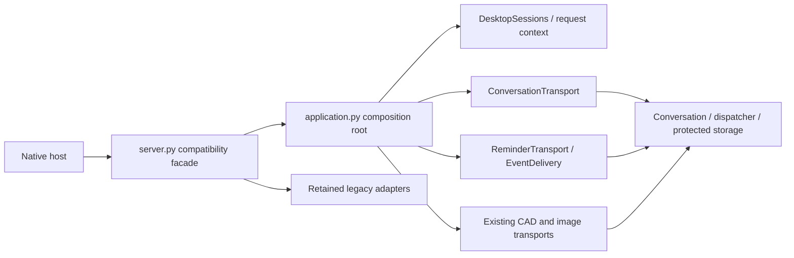

# Core composition and desktop sessions (R2a)

Implemented 14 October 2026. `backend/server.py` remains the supported desktop entry point and the native host continues to start it. This checkpoint separates ownership; it does not complete the R2b authorization migration or introduce a second runtime.

## Ownership

`create_application()` accepts settings, project root, protected database/project/socket overrides, and explicit compatibility callbacks. Importing `application` constructs no profile or runtime and imports no optional media/model implementation. The composition root constructs the shared dispatcher, scheduler, conversation store, creative services/transports, resource governor, event bus and lazy legacy adapters. Tests construct isolated roots instead of replacing production server globals.

`Application` owns FastAPI/ASGI construction, `/status`, the reminder poller, event subscription and shutdown. Repeated start is idempotent. Startup failure rolls back its poller/subscription. Shutdown closes both creative transports, invokes the explicit legacy-media stop adapter, cancels/awaits owned tasks and removes the bus observer, including on cleanup failure. The observer can be registered again on a native retry without duplicate delivery. Standalone uvicorn owns signal shutdown through lifespan; the old import-time force-exit handler is removed. Native tray signals retain the native host's existing shutdown path.

`DesktopSessions` owns token validation, UUID owner identity, role mapping, the native-owner check, native recipient registration, channel removal and owner-room lookup. The native bridge has one authoritative location on this session registry. Settings and the optional face gate are injected; face landmarks remain a legacy local gate, not strong OS authentication. Existing desktop development behavior (SID identity when no client UUID is provided, optional explicitly configured token) is preserved. Mobile grants/pairing are not implemented.

`RequestContext` is an immutable owner/project snapshot. Conversation requests capture it before the first asynchronous processing notification, preventing a concurrent project switch from changing the request's destination. Existing creative RPCs receive their context through the same registry. The selected project remains the existing desktop-wide selection; this is not a per-device project protocol. Durable service checks still bind conversation/request/job records to owner and resolved project.

`ConversationTransport` and `ReminderTransport` register their existing wire names directly. `EventDelivery` owns owner/renderer job updates, durable reminder recipient selection/receipt and the explicitly named legacy event bridge. No extracted module imports `server`. `server` retains named method/object aliases only for local host/legacy compatibility. Assigning a replacement to an old service alias does not reconfigure the composition root: use constructor dependencies or the feature transport's service boundary. The isolated image verification script now follows this boundary.

Disconnecting one channel preserves another connected channel's approvals. The last renderer still stops its owner's CAD/image jobs and planner approvals. When the final owner channel disconnects, the conversation dispatcher rejects outstanding approvals; durable history and request ledgers remain available for reconnect without replay.

## Migrated transport inventory

This inventory records current behavior, not a new universal role/grant policy. The complete direct-route policy matrix is R2b.

| Route / owner | Request and context | Policy and response | Timeout / cancellation |
| --- | --- | --- | --- |
| `user_input` / conversation transport | `ConversationRequest`; connected owner and captured project | Existing dispatcher authentication/tool permissions/owner approvals; results, transcript and errors to requesting SID | Existing conversation/provider/tool deadlines; durable dedupe; owner disconnect resolves approvals |
| `resume_conversation` / conversation transport | `ResumeConversation`; owner and selected project | Authenticated, store enforces owner/project; restored/failure event to SID | Bounded local history; no provider work |
| `create_reminder`, `snooze_reminder`, `cancel_reminder` / reminder transport | Existing scheduler tool schemas; connected owner | Shared dispatcher permissions/approval; error/result to SID; refresh to same-owner channels | Existing dispatcher deadline/approval cancellation |
| `get_reminders`, `acknowledge_reminder`, `dismiss_reminder` / reminder transport | Existing reminder/delivery IDs and connected owner | Authentication and store's delivery owner; same-owner refresh and SID error | Transactional claim/receipt and persistent retry IDs |
| `cad_*`, `image_*` / existing creative transports | Existing validated RPC schemas; renderer role, owner, resolved project from registry | Existing common dispatcher and creative permissions; scoped ACK/errors; updates to owner's renderer channels | Owned service/planner workers, shared creative slot, close/disconnect cancellation |
| Reminder poller / event delivery | Store claims per authenticated owner | Workspace control channels excluded; resident prefers tray/native; Studio prefers renderer; receipt only after native notice queued | Existing delivery lease/retry policy; poll task owned by lifespan |
| `/status` / application | No privileged action; existing runtime/resource metadata | Existing local status response shape | Lifespan constructs and releases dependencies |

Job updates retain their project field and owner/renderer routing. Persistent artifact access is project-scoped. The global desktop selected-project model and unscoped legacy broadcasts must not be exposed as a multi-device authorization boundary.

## Explicit remaining legacy seams (R2b/R2c/R6)

- `server.py` still contains connection hydration/optional face callbacks, native control/resource handlers, legacy audio/browser/CAD/memory, printer/device actions and settings handlers. Its named aliases map to root-owned services rather than duplicating implementations.
- Several direct device/desktop/printer/memory/settings/legacy creative routes still bypass the common dispatcher or use broad broadcasts. The `LEGACY_EVENTS` bridge intentionally preserves those existing broadcast contracts and makes no owner-isolation claim. No mobile exposure is enabled. R2b must inventory every handler, migrate grants/validation/scoped errors and test direct calls.
- `launch_app` has a shared dispatcher registration whose implementation still closes over the legacy desktop adapter in the facade. Its direct route is covered by the existing permission test; move registration with its adapter during R2b/R2c.
- Legacy audio state, optional face authentication and printer monitoring are retained behind `_stop_legacy_media` and the root-owned task list. Full media-session ownership/consolidation remains R6. The live voice/tool dispatcher is still separate.
- Active `backend/core/` imports (including the event bus/reminder store) remain supported. The only event-bus addition is explicit global-observer removal; no core modules were archived. Schema/declaration consolidation and the reference manifest remain R2c.

## Verification

**161 Python checks pass; one existing real-Blender check is skipped.** The 15 new checks cover independent composition roots, side-effect-free imports, malformed/token/owner handshakes, roles/face gate/project snapshots, owner-only renderer updates, project-switch races, durable reconnect/no replay, foreign owner/project rejection, multi-channel disconnect, repeated lifecycle, startup rollback and cleanup failures. Existing transport tests now use fresh injected roots where the extracted boundary is public. Ruff covers the new modules through the updated include list. All 26 frontend checks also pass.

Actual isolated native verification passes busy-port recovery, same-identity close/reopen, hotkey-message reopen, renderer-crash cleanup, reminder receipt, gaming guard and graceful core stop. Its 10-second sample measured 65.57 MB mean aggregate working set, 48.03 MB peak private bytes and zero Electron processes, including the venv launcher. This is a short regression observation, not a replacement for the prior ten-minute baseline or a real-game benchmark. The injected-crash scenario still logs the existing bounded Engine.IO graceful-shutdown timeout; the core exits and the verifier passes. [Native evidence](qa/r2a-native-verification.json).

The actual native CAD renderer imports real GLB, builds box/bracket/enclosure and a three-object material scene, downloads exports and restores without rebuilding. Four owned workers exit; geometry libraries stay absent from the resident. Desktop/768/390 layouts pass. [CAD evidence](qa/r2a-cad-verification.json).

The actual native image renderer verifies unconfigured controls, labelled fixture revisions/downloads, cancellation and restore without regeneration. Three fixture workers exit; diffusion/model libraries stay absent from the resident. Real image inference remains unconfigured/unverified. [Image evidence](qa/r2a-image-verification.json).

The retained Electron fallback lifecycle is also checked separately. No frontend source or visual design changes are part of this checkpoint; existing built UI assets are exercised by these renderer checks. Provider/model setup, physical camera/hand acceptance, real Blender/diffusion execution and the real-game benchmark remain deferred/unverified. WhatsApp reply tools remain excluded.

## Next checkpoint

R2b: enumerate every supported socket/direct tool route and its request schema, caller role/owner/project, permission/approval, scoped response, timeout/cancel owner and replacement. Migrate the remaining direct-handler policy paths through the existing dispatcher in bounded groups, keeping names/payloads compatible or providing a tested adapter. Do not turn the local desktop handshake into phone grants or replace the active runtime with the archived core server. R2c then consolidates schemas/declarations and classifies legacy files against actual references before retirement.
