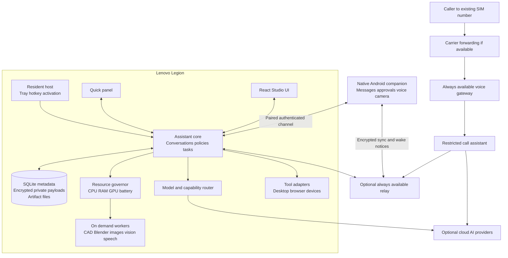

# INARA laptop and Android architecture plan

Plan date: 13 October 2026. Intended devices: a Lenovo Legion laptop running Windows and a Samsung Galaxy Z Fold8. Exact laptop GPU, VRAM and RAM remain to be detected. Preserve the existing SIM number and personal WhatsApp account. The current implementation findings are in [INARA project review](PROJECT_REVIEW.md). The detailed organization and interface work is in [Code cleanup and JARVIS interface plan](UI_AND_CODE_CLEANUP_PLAN.md), with a scoped next task and model recommendation in [Implementation handoff](IMPLEMENTATION_HANDOFF.md).

Build INARA as a lightweight resident assistant with a full creative workspace and an Android companion. Use local processing for activation, routine actions, private memory and tracking. Offer cloud assistance for complex reasoning, higher-quality generation and telephone conversations. Start heavy local workers only when requested, and let the resource manager defer them while gaming or on battery.

Keeping the existing phone accounts is a product requirement. The supported baseline includes owner-approved personal WhatsApp notification summaries. Reply drafting and sending are deferred capabilities, invoked only by a specific owner request; receiving a message never starts a reply. General AI conversations on SIM calls require a validated carrier-forwarding path or a supported OEM integration. General AI answering of personal WhatsApp calls is a feasibility constraint, not a committed feature.

## Product behavior

| Mode | User experience | Resources and lifetime |
| --- | --- | --- |
| Resident | Tray icon, hotkey, optional local wake phrase, reminders and paired-phone events | Small service persists when windows close. No large language model, camera or creative worker stays loaded by default. |
| Quick assistant | Small chat or voice panel for opening apps, finding files, reminders, answers and message review | Start only the required speech or reasoning adapter. Return to resident mode after an idle timeout. |
| Studio | Full workspace for CAD, Blender, images, coding, browser tasks and camera tools | Workers and previews load on demand. Jobs survive closing the workspace unless cancelled. |
| Game or battery | Quiet assistant with push-to-talk or hotkey access and urgent notifications | Defer GPU generation, indexing and camera watches. Permit cloud execution when enabled. |
| Android | Chat, voice button, message inbox, approvals, call summaries, camera sharing and laptop job control | Native event-driven app. No large model or continuous camera runs in the background. |

Opening Studio exposes tools; it does not start every tool. A job launched by voice can start the same worker without opening Studio, subject to the selected resource policy. Closing a window releases its preview resources without silently losing the job.

Examples of the intended experience:

- During a game: “INARA, remind me in 20 minutes.” The reminder is created locally without loading a reasoning model.
- In Studio: “Design a controller stand for these dimensions.” INARA proposes parameters, builds geometry, displays measurements and saves an editable revision.
- From the phone: “Make the stand wider.” The same project opens on the laptop worker; the phone receives a preview and completion notice.
- For messages: “What did I miss?” INARA summarizes allowed notifications. It drafts a reply only after an instruction such as “Draft a reply to this message”; drafting alone does not authorize sending.
- After a forwarded call: “The courier asked for a delivery time. I used your approved delivery instructions and created a callback task.” The owner receives the actual result and transcript excerpt.

## Architecture



This is one modular application with supervised worker processes. Use a persistent local job queue; a single-user installation does not need a cluster, Redis or independently deployed microservices. The voice gateway is separate because calls must have a reliable destination when the laptop is asleep.

## Technology choices

Implementation decision, 14 October 2026: the measured Python/Win32 host meets the local idle target without retaining a webview or adding another resident runtime. Keep Electron for the on-demand Studio and defer a Tauri migration unless installation or compatibility evidence justifies it. See [native host measurements and acceptance limits](NATIVE_RESIDENT.md).

| Layer | Proposed choice | Reason and qualification |
| --- | --- | --- |
| Resident host and Windows shell | Python/Win32 tray and core; Electron 44.7.0 only for an open workspace | Measured 64.86 MB mean / 65.30 MB peak combined resident working set. Retain the tested React/WebGL workspace; Rust/Tauri remains an optional future packaging evaluation. |
| Studio UI | Reuse React and Zustand; introduce TypeScript, lazy routes and generated contracts | Preserve the visual work and Three.js viewer while reducing startup and contract errors. |
| Assistant core | Python, FastAPI and typed Pydantic requests | Reuse existing integrations, with a small import graph and no model initialization at import time. |
| Desktop transport | Native IPC to the host; authenticated loopback API for Python | No unauthenticated fixed port. Launch-scoped credentials and strict allowed origins. |
| Android | Kotlin, Jetpack Compose, Room and Android Keystore | Direct access to Android service lifecycles, notification actions and foldable layouts. |
| Data | SQLite in WAL mode, artifact directories and encrypted sensitive payloads | Transactional jobs and reminders without a separate database service. SQLite itself is not automatically encrypted. |
| Local reasoning | Managed llama.cpp process; optional Ollama adapter | Start and unload models explicitly, with bounded context and a tested tool schema. |
| Local speech | Evaluate sherpa-onnx for streaming speech, VAD and keyword detection; retain a working wake-word adapter where useful | Choose models through accuracy and resource measurements on these devices. Runtime and model licences are separate. |
| Mechanical design | Implemented bounded stdlib mesh worker; build123d remains a future engineering adapter | Offline parametric box/bracket/enclosure with validated STL/GLB now works. Add richer geometry and STEP through an isolated kernel later. See [CAD Studio](CAD_STUDIO.md). |
| Artistic 3D | Blender worker plus a small Blender integration for approved scene operations | Edit objects, materials, lighting and procedural scenes while preserving native project files. |
| Image generation | Cloud image adapter initially; optional local ComfyUI worker | Good results before large downloads; reusable local workflows when the laptop has capacity. |
| Tracking | MediaPipe or equivalent compact ONNX models | Local hand, face and pose landmarks without continuously invoking a multimodal cloud model. |
| Remote connection | Paired TLS channel on LAN; optional encrypted relay or private VPN for remote use | Avoid exposing the desktop automation API directly to the internet. |

Tauri uses an OS webview and supports external sidecars. That makes it a sensible candidate for this design, but memory and media compatibility still need measurement with this UI and Python service. [Tauri architecture](https://v2.tauri.app/concept/architecture/), [Tauri sidecars](https://v2.tauri.app/develop/sidecar/).

llama.cpp provides a local inference runtime. sherpa-onnx supports local speech capabilities and Android among its targets. These are candidate runtimes, not promises about the speed or quality of a particular downloaded model. [llama.cpp project](https://github.com/ggml-org/llama.cpp), [sherpa-onnx project](https://github.com/k2-fsa/sherpa-onnx).

Resolve supported stable dependency versions when implementing each phase and lock the tested versions. Maintain a model compatibility manifest and worker environment locks. Upgrading every library to its newest major version in one change would obscure compatibility failures.

## Core services and contracts

The assistant core should contain a conversation service, deterministic command router, policy service, tool registry, job scheduler, artifact service, memory service, device registry and sync service. Speech, camera, desktop control and creative tools are adapters to these services.

Every input becomes a request containing `request_id`, authenticated `principal_id`, `device_id`, `conversation_id`, optional `project_id`, modality, deadline and data-sharing policy. A model can propose a tool action, but the core decides whether it is authorized. UI buttons, voice, Android and remote calls use the same dispatcher.

Each tool declares an input/output schema, scopes, side effects, allowed project roots, execution location, deadline, cost class and resource requirements. Use explicit permission values such as `deny`, `ask` and `allow_within_scope`; the current boolean means “requires confirmation” and is too easy to misinterpret.

Jobs have durable states: `queued`, `waiting_for_approval`, `waiting_for_resources`, `running`, `succeeded`, `failed` and `cancelled`. Retriable work gets a bounded retry count. Recovery after a crash distinguishes safe regeneration from external actions whose result is unknown. Never automatically replay a message send, call placement or print start because an acknowledgement was lost.

An event envelope includes schema version, event ID, request/job ID, device, conversation, project, timestamp and payload. Clients reconnect with an event cursor and receive a state snapshot plus later events. Keep Socket.IO as a temporary legacy bridge, then introduce versioned APIs such as:

```text
POST /v1/conversations/{id}/messages
POST /v1/jobs
GET  /v1/jobs/{id}
POST /v1/jobs/{id}/cancel
POST /v1/approvals/{id}/decision
GET  /v1/artifacts/{id}/content
GET  /v1/capabilities
WS   /v1/events
```

Audio uses a transport appropriate to the provider and client. Cloud browser/mobile voice can use WebRTC, while server audio bridges may use WebSockets or SIP. Tool execution and credentials remain in the controlled backend. [Official OpenAI documentation on WebRTC](https://developers.openai.com/api/docs/guides/voice-webrtc), [server controls](https://developers.openai.com/api/docs/guides/voice-server-controls).

## Resource management

The numbers below are proposed acceptance budgets, not measurements of the existing app. Record actual aggregate process working sets, private memory, CPU time, GPU allocations and battery behavior on the Legion before committing the defaults.

| Situation | Initial target | Policy |
| --- | --- | --- |
| Resident with hotkey only | At most 150 MB aggregate RAM; average CPU below 1% over ten idle minutes | No webview, local language model, webcam or creative worker |
| Resident with local wake detection | At most 250 MB aggregate RAM; average CPU below 2% | Only compact activation runtime; no continuously open cloud audio session |
| Quick panel without a local reasoning model | At most 400 MB aggregate RAM | Minimal renderer; speech starts as needed |
| Studio without a large preview or model | At most 800 MB aggregate RAM | Lazy tools and demand-based rendering |
| Gaming | No discrete-GPU model allocation by the resident assistant | Queue heavy work; avoid overlays or process injection into games |
| Local generation | One substantial GPU job by default | Admit only when measured free VRAM and RAM satisfy the workflow plus reserve |
| Camera | Off until requested | Start with 720p capture and 10–15 tracking updates per second; raise only when needed |

Distinguish hotkey responsiveness from model cold start. Target panel visibility below one second and deterministic action acknowledgement below 500 ms under normal idle load. Measure voice response latency separately for warm local, cold local and cloud routes. Loading a local model can add several seconds; the interface should show this state and permit a different route.

At installation, detect CPU, RAM, GPU/VRAM, driver, available disk and power settings. Benchmark a small task rather than using “Legion” as a hardware specification. Suggested starting profiles:

| Available hardware | Initial local strategy |
| --- | --- |
| 16 GB RAM and roughly 4–6 GB VRAM | A 2–4B quantized model on demand; cloud for difficult reasoning and most images; CPU CAD; small scenes |
| 32 GB RAM and roughly 8 GB VRAM | Test a 7–8B quantized model with bounded context; unload it before image generation; sequential creative tasks |
| 32–64 GB RAM and 12–16 GB VRAM | Evaluate larger models or higher-quality image workflows, still with explicit admission control |

These are starting heuristics. Model architecture, quantization, context cache, image resolution and other applications all change memory use. A four-bit 8B model has roughly 4 GB of raw weight data before quantization metadata, caches and runtime overhead; it is not a 4 GB total-memory promise.

The governor grants leases for GPU and high-memory jobs, using actual free capacity rather than just installed capacity. Reserve headroom for Windows and foreground applications. On game start, unload INARA-owned idle models and defer new heavy jobs. An active job pauses at supported checkpoints or is cancelled explicitly; arbitrary kernels cannot always be suspended safely. After work, request worker unload and terminate the worker if it retains allocations. Release leases only after confirmed exit or measured release.

On battery or thermal pressure, reduce capture frequency and inference threads, suspend indexing and prefer approved cloud routes. Keep configurable model disk quotas and an offline cache. Do not silently download tens of gigabytes or keep several inference stacks resident.

## Reasoning and voice

Use three decision levels. A deterministic router handles recognized local commands. A small local model handles conversational assistance and modest tool selection. A cloud specialist handles difficult code, complex planning or multimodal requests when the selected privacy and spending policies permit it.

Route by task capability, context size, latency target, local resource availability and cost. The router must be able to say that a requested offline task exceeds available capacity. Store model IDs, supported modalities, tool behavior, fallback order and context limits in configuration. Test provider access and schema compatibility instead of scattering provider-specific code through agents.

As a current migration starting point, Google's catalog identifies `gemini-3.8-live` for the old live-audio path and `gemini-3.8-flash` for several retired general-purpose paths. Treat CAD coding, browser control and images as separate evaluations; changing a model string does not preserve an old computer-use schema. [Gemini model migration schedule](https://ai.google.dev/gemini-api/docs/deprecations).

Voice activation should happen locally. After wake or push-to-talk, open the chosen local or cloud session, retain a short in-memory preroll and support interruption. When the session ends, disconnect cloud audio, discard preroll and return to wake-only mode. Local STT/TTS must be real implementations; the current modules named `stt` and `tts` largely process transcripts and audio from a provider.

Use stable audio-device identifiers and a validated mapping between browser and native audio devices. Handle headset changes, Bluetooth switching, sleep/resume and missing microphones. One audio manager owns the room microphone and speakers. Phone call media remains separate from room audio. Add acoustic echo handling and bounded audio queues.

Evaluate speech with fan noise, game audio, headset use, English and Malay, and any additional languages selected by the owner. Start with hotkey/push-to-talk as the reliable path. A custom “Hey INARA” detector needs its own evaluation; the current archived detector uses a Jarvis wake model as a proxy.

## Creative workspace and feature priorities

| Capability | First useful release | Later additions |
| --- | --- | --- |
| Daily assistant | Local reminders, app launching, selected-file search, chat, voice and task history | Calendar/email connectors, document explanations, bounded routines |
| Mechanical CAD | Prompt plus parameters, editable model, dimensional validation, STEP/STL export, revisions | Assemblies, tolerances, constraints and comparisons |
| Artistic 3D | Blender objects, materials, lights, procedural scenes, `.blend` and GLB export | Geometry Nodes workflows, animation, rigging and evaluated image-to-3D services |
| Images | Reference images, generation/editing, masks, variant gallery and artifact history | Local ComfyUI workflows, upscaling and controlled reusable styles |
| Camera | Local hand/pose tracking and selected-frame questions | Motion-triggered watches, user-defined zones, calibrated control and phone camera input |
| Browser and desktop | Selected-app context, Playwright tasks, structured actions and previews | Vetted application adapters and scoped MCP connectors |
| Devices and printing | Working Kasa/HA aggregation and validated OctoPrint/Moonraker workflows | Capability-tested printer adapters and richer automation |
| Android communications | Allowed notification summaries, approvals and missed-call tasks | Replies only on specific owner request; carrier-forwarded conversational calls where validated |
| Memory | Project retrieval, explicit preferences and editable facts | Retrieval across approved collections and reviewed routine suggestions |

Make the JARVIS visual identity the primary interface: a dark instrument-panel layout, cyan HUD accents, a responsive voice core and meaningful activity transitions. Use a compact quick panel and a dockable Studio workspace with project navigation, a conversation/task column and an artifact canvas. Provide Chat, Create, Vision, Inbox, Devices and Jobs destinations. A persistent status area shows local/cloud execution, microphone/camera activity and the current job. The [interface plan](UI_AND_CODE_CLEANUP_PLAN.md) specifies layout behavior, design tokens, accessibility and performance gates.

Use progressive previews and an understandable activity log: planning, building, validating, rendering and saving. Do not make provider internal thoughts a product dependency. Show the result, errors and retry reasons. Include cancel, undo, compare revisions, open in the native app and export controls. Stop animations and Three.js rendering when the view is hidden.

## 3D model vibe coding

Mechanical CAD and artistic meshes need different pipelines. Ask only for dimensions or constraints that materially affect the result. An artistic mesh from text or an image does not establish manufacturing accuracy.

For CAD, the model produces a structured design specification: units, named parameters, primitive/sketch operations, constraints, feature IDs and expected dimensions. A trusted adapter turns allowed operations into build123d geometry. Validate bounds, solid validity, expected volumes, clearances and export success. Save the specification, source generated by the trusted adapter, an editable STEP artifact, STL where needed, preview renders and a validation report. build123d supports STEP and mesh export formats. [build123d import and export documentation](https://build123d.readthedocs.io/en/latest/import_export.html).

For Blender, use a scene operation schema with persistent object IDs, meshes, transforms, materials, lights, cameras and a restricted node library. Start with coarse geometry and a fast preview. Render several views and inspect the output before final export. Preserve a `.blend` project and GLB for the viewer. Later support topology checks, UVs, rigging and image-to-3D adapters after measuring quality, licence terms and costs.

Each iteration modifies a revision rather than rewriting a single shared `current_design.py`. Use unique job directories and revision ancestry. An instruction such as “increase the height to 140 mm” updates one parameter; “add a hole here” can reference a selected feature and coordinate system. Measure the rebuilt object against the request before announcing success. Repair attempts stop after a bounded number of iterations and preserve the last valid artifact.

Run previews with capped resolution, samples and scene complexity. Rendering may need GPU resources while CAD construction can usually proceed on CPU. Raw Python scripts are an advanced capability, requiring a verified restricted execution environment. A subprocess or AST filter alone is not a security sandbox. Prefer the operation schema on machines without a suitable isolated execution option.

The print workflow is a separate sequence: validate model, choose a saved printer/material profile, slice, show an estimate, upload, then start after the configured approval. Preview generation must not implicitly start a physical print.

## Images and camera tracking

Add image generation through a common job/artifact interface. Cloud generation is the initial high-quality path; local generation is an optional download and worker. Store prompt, referenced artifact IDs, dimensions, seed where supported, workflow/model versions and outputs. Editing retains the original and saves a new revision.

ComfyUI exposes workflow submission, queue/history, progress events, interruption and model unloading. Wrap only approved workflows and reviewed node sets in a local adapter. Custom nodes are executable extensions and require version control and isolation from the core. Keep its server on loopback and do not expose its API as the phone endpoint. [ComfyUI server routes](https://docs.comfy.org/development/comfyui-server/comms_routes).

The camera service owns acquisition and shares a frame buffer with subscribers. Tracking consumes low-resolution local frames; semantic vision receives only the frame or region needed for the user's question. Use one acquisition path for the selected camera, timestamp every frame and reject stale inputs after disconnects. Phone camera streaming is foreground and visibly enabled.

For watches, run a cheap local trigger first, then an optional semantic check. Add minimum confidence, persistence across frames, cooldown and a clear “camera unavailable” state. Avoid treating an API error or missing key as proof that a condition is absent. Gesture control needs calibration, smoothing and activation/deactivation controls. Face tracking can support presence or avatar motion without being used to authorize sensitive tools. [MediaPipe hand landmark guide](https://developers.google.com/edge/mediapipe/solutions/vision/hand_landmarker).

## Android companion and personal WhatsApp

Build a native companion rather than wrapping the desktop web app. On the Fold8 cover screen, show a compact conversation and action inbox. When unfolded, use list/detail panes for messages, job previews or project control. Preserve state across folding, resizing and multi-window use. Android's adaptive Compose APIs support window-size and posture-aware layouts. [Android adaptive app guidance](https://developer.android.com/develop/ui/compose/layouts/adaptive/get-started-with-adaptive-apps).

The first Android release should support paired-device chat, push-to-talk, local reminders/notes, artifact previews, approval cards, approved notification ingestion and camera sharing while the app is visible. WhatsApp reply drafting and sending are excluded from the initial release and can be added only following a specific owner request to implement them. Use event-driven services and scheduled background sync. Push notifications can announce available encrypted data; they should not contain private message bodies. A persistent socket is appropriate while the app is active, not a guarantee of background delivery.

Android restricts background service and microphone starts. Use explicit foreground sessions with visible indicators when required; do not promise an unrestricted always-listening phone assistant. [Android foreground service restrictions](https://developer.android.com/develop/background-work/services/fgs/restrictions-bg-start).

Personal WhatsApp assistance should use owner-enabled notification access. `NotificationListenerService` can receive posted notifications. Keep reply actions outside the initial implementation. If the owner later specifically requests reply functionality, evaluate `RemoteInput` on the actual Fold8; a particular WhatsApp version, notification or phone state may not expose a usable reply action. [Android notification listener](https://developer.android.com/reference/android/service/notification/NotificationListenerService), [Android RemoteInput](https://developer.android.com/reference/android/app/RemoteInput).

The proposed message flow, including the deferred reply capability, is:

1. Receive a notification only from an allowed app/conversation. Normalize sender, time and visible text; deduplicate grouped notification updates.
2. Apply sensitive-content rules locally. Exclude OTPs and avoid forwarding private groups by default.
3. Summarize recent captured context through the chosen approved route. A summary request does not authorize a draft or a send.
4. Once reply functionality has specifically been requested and implemented, draft only in response to a direct owner instruction identifying the message or recipient. Draft-only instructions keep sending disabled. A send instruction must identify the recipient and final text, or refer unambiguously to the reviewed draft.
5. For an explicitly authorized send, validate the recipient and action at execution time. Use a still-valid reply action if supported; otherwise open the messaging app for the owner to send. Record the outcome as submitted, confirmed or uncertain according to available evidence. Never resend automatically after an ambiguous result.

This captures notifications, not complete chat history. Messages may be unavailable when previews are hidden, WhatsApp is foreground, notifications are suppressed, or an action expires. A new conversation or media message may require opening WhatsApp. Voice notes need an explicit share/import workflow. Automatic replies and acknowledgements are excluded. Incoming notifications, reminders, scheduled routines, generic requests for help and a previously approved reply cannot authorize a new reply. The core enforces this policy independently of model instructions.

Personal WhatsApp calls remain with WhatsApp. INARA can present missed-call information when available and offer a callback task. Meta describes its calling API as a capability of the WhatsApp Business Platform. That does not establish an API for answering arbitrary calls on the owner's personal account, so this plan does not depend on one. [Meta WhatsApp Calling API](https://developers.meta.com/resources/videos/whatsapp-calling-api/).

Business calling can be a later alternative if the owner changes the account requirement. Validate business registration, number eligibility, regional availability and calling permissions before proposing migration. Do not move the personal account as part of this revamp. [Twilio WhatsApp Business Calling requirements](https://www.twilio.com/docs/voice/whatsapp-business-calling).

## SIM calls while keeping the number

An ordinary Android app can screen calls, but the documented call-audio capture path requires privileged pre-installed access. Becoming a default dialer or notification listener is not a general media bridge. [Android call screening](https://developer.android.com/develop/connectivity/telecom/dialer-app/screen-calls), [Android call audio restrictions](https://developer.android.com/media/platform/sharing-audio-input).

Samsung provides built-in call screening on supported software, with live transcripts and Text call. Validate its presence on this Fold8, firmware, language and region. It can provide useful SIM screening immediately, but do not assume third-party control or automatic transcript export to INARA. Offer a manual share/import path where the phone exposes one. [Samsung call screening](https://www.samsung.com/us/support/answer/ANS10010345/).

For a full INARA conversation using the existing SIM number, prototype conditional carrier forwarding for busy, unanswered or unreachable calls to an assistant voice endpoint. Callers still dial the original number. The media bridge terminates the forwarded leg at a programmable voice/SIP service, where INARA can receive and send audio. Twilio's bidirectional Media Streams is one candidate transport. [Twilio Media Streams](https://www.twilio.com/docs/voice/media-streams).

Carrier forwarding support, charges, forwarded caller identity, destination eligibility and number availability must be confirmed for the actual carrier. Normal answered SIM calls stay on the handset. Forwarding does not route personal WhatsApp calls, transfer SMS, or guarantee outgoing calls present the original SIM caller ID.

Avoid forwarding loops: an assistant transfer back to the same forwarded number can re-enter the assistant. Prefer handoff to an authenticated app VoIP session, another configured destination, or a request that the owner calls back. Provide a visible forwarding state and a tested way to disable it. If the assistant gateway fails, use the provider's configured fallback message or voicemail. An internet-dependent assistant cannot handle calls during a gateway outage.

The call assistant should identify itself, collect caller name and purpose, answer only from owner-approved facts, and distinguish a request from a commitment. A caller is a separate principal with access to a small public/delivery knowledge collection. Calls cannot trigger desktop execution or access the owner's private memory. Configured caller rules may create reminders or callback requests, but cannot disclose secrets or make unrestricted commitments.

Save a final result containing call ID, caller identity as reported and verified where available, reason, answers given, requests, urgency, follow-up, completion state and transcript excerpts. Deliver it to phone and laptop with clear provenance. Add interruption, timeout, DTMF where the transport supports it, human handoff and bounded call duration. Voice media has explicit codec and sample-rate metadata per adapter.

The always-available gateway can host a small call service using cloud speech and approved cached facts. It does not need the laptop GPU. Alternatively, a personally maintained always-on SIP host can own this role, with its own reliability and maintenance cost. Restrict and validate webhooks and media stream identity. [Twilio webhook security](https://www.twilio.com/docs/usage/webhooks/webhooks-security).

## Memory security and sync

Use separate owner preferences, project memory, conversation history and tool execution records. Memories have a source, scope, creation time and optional expiry. The owner can inspect, correct and forget them. Retrieve a bounded selection of relevant material instead of concatenating every project text file into the model context.

The data model should include projects, conversations, messages, artifacts, revisions, jobs, events, approvals, devices, capability grants, reminders, call records and notification records. Save large files outside SQLite using artifact IDs, content hashes and manifests. Serve binary data or preview references instead of repeatedly broadcasting base64 assets.

Use OS-protected secret storage on Windows and Android Keystore on the phone. Encrypt sensitive stored payloads before they reach the database or WAL, and keep plaintext metadata minimal. Pair devices through a QR code, verify device identity, support revocation, expire action grants and prevent replay. Use established cryptographic libraries and protocols; do not design custom encryption. The relay carries encrypted sync payloads, while cloud AI receives only content explicitly selected for cloud execution. PSTN call media is a separate trust boundary and is not made end-to-end encrypted by the sync channel.

Every action checks its scope at execution time, including UI buttons. Confirmations bind the principal, tool, argument hash and expiry. Canonical path containment includes junction/symlink handling. Browser content, caller speech, camera text and retrieved documents are untrusted inputs; they cannot expand tool permissions. Plugins and MCP servers run under scoped grants and start only when needed.

Require explicit owner authorization for sending messages, placing calls, printing, destructive filesystem changes and similar external effects. A sufficiently specific instruction can supply that authorization; do not request it again unless the intended action changes or remains ambiguous. WhatsApp has the additional request-only policy above, with no standing automatic reply grants. Allow established low-impact routines within explicit grants. Remote callers have their own much narrower grants. Use OS authentication for sensitive owner actions, subject to hardware support; a normal webcam landmark match is insufficient.

Reminders store UTC timestamps plus an IANA timezone for calendar recurrence, with `Asia/Kuala_Lumpur` as the initial client timezone. Use transactional claiming and deduplicated delivery across phone and laptop. Configure which device owns each reminder; sync is not a licence to fire two independent notifications indefinitely. Resolve edits and deletion tombstones by record version.

When the laptop is asleep, the phone retains notes, reminders, captured notifications and approved small offline behaviors. Heavy requests queue with a visible unavailable state. A configured cloud route can answer chat or calls independently, with only the knowledge supplied to it. Do not promise immediate laptop execution or universal remote wake.

## Migration sequence and release gates

Avoid a simultaneous shell, backend, model and mobile rewrite. Preserve user data, introduce the new contracts and move one integration at a time. The archived core modules are source material to inspect and adapt, not a drop-in production replacement.

| Phase | Work | Exit criterion | Approximate focused effort |
| --- | --- | --- | --- |
| 0 | Preserve data; inventory hardware; verify model access; prototype Fold8 notification ingestion and carrier forwarding | Supported capability matrix and baseline measurements, with phone feasibility resolved early | 1–2 weeks |
| 1 | Independent text service, shared tool policy, typed contracts, locked core dependencies, path containment, reminder fix and recoverable sessions | Text works without mic permission; direct and model actions enforce the same scopes; no repeated reminder alerts | 2–3 weeks |
| 2 | Resident lifetime, hotkey/wake adapters, resource governor, JARVIS design system, responsive layout, lazy UI, shell comparison and installation prototype | Window close retains reminders; reopen resumes state; layout and accessibility checks, measured idle budget and game policy pass | 2–3 weeks |
| 3 | CAD and Blender workers, artifact revisions, validation and export | A reference suite produces editable files with correct units/dimensions, preserved revisions and cancellation | 2–3 weeks |
| 4 | Image adapter, optional ComfyUI bundle, tracking and shared capture | A local image job releases its allocations; tracking works without a cloud key; camera stops on disable | 1–2 weeks |
| 5 | Native Android companion, pairing, notification summaries, approvals, local notes and sync recovery | Fold/unfold, offline operation and app restart preserve state; WhatsApp draft/send tools are absent from the initial release | 3–4 weeks |
| 6 | Validated forwarded SIM call pilot and final summaries | Receive, interrupt, summarize and hand off test calls with laptop asleep; forwarding loop and outage tests pass | 1–3 weeks, carrier dependent |
| 7 | Browser/devices/printing migration, signed installers, updates, recovery and endurance tests | One supported release with diagnostics, backups, migration rollback and documented capability limits | 2–3 weeks |

Expect roughly four to six months for a focused solo implementation of the broad system, with estimates revised after Phase 0. A small team may overlap independent work, but hardware, Android and carrier prototypes remain release dependencies. Personal WhatsApp call automation has no delivery estimate under the current account requirement.

The first useful milestone is narrower: a recoverable laptop assistant that handles text independently of voice, local reminders, app launching, hotkey activation and one validated CAD workflow. Follow with the Android inbox and project controls. Full call handling should not delay that milestone.

## Repository organization

```text
apps/
  desktop/                 React Studio and target native shell
  android/                 Kotlin companion
services/
  assistant/               Lean Python core and adapters
  relay/                   Optional encrypted sync service
  voice_gateway/           Optional externally reachable call service
workers/
  speech/                  Small local speech environment
  cad/                     build123d environment
  blender/                 Blender bridge and operation schemas
  images/                  Approved ComfyUI workflows and adapter
  vision/                  Tracking and semantic vision adapters
packages/
  contracts/               Versioned schemas and generated client types
  capability_specs/        Tool schemas and permissions
tests/
  unit/                    Pure logic and policy tests
  contracts/               Desktop Android worker and provider contracts
  integration/             Explicit API hardware and telephony tests
  scenarios/               Recovery latency and task success evaluations
docs/                      Architecture capability matrix and runbooks
```

Start by introducing these boundaries within the current folders where practical; physical file moves can follow stable contracts. Use separate locked environments for CAD, speech/vision and ComfyUI to avoid incompatible binary dependencies. Package a lean default install, downloadable feature bundles and explicit model downloads. Data belongs in a versioned user-data directory, not the source checkout.

## Validation and operating costs

Evaluate useful outcomes. Include reminder recurrence and reboot recovery, restricted paths, caller versus owner permissions, reconnect deduplication, audio changes, geometry validity, editable exports, image cancellation, stale camera frames, device failures and call interruptions. Verify that a notification or summary request cannot draft or send a WhatsApp reply, and that draft-only requests cannot send if the deferred capability is later added. Keep real API, printer and call tests opt-in. Current tests should be retained where useful, but exception-swallowing tests need assertions before they count toward a release gate.

Measure ten-minute idle runs with and without wake detection, representative gaming sessions, cold/warm activation, repeated worker start/stop and several hours of mixed use. Set regression thresholds from the Legion baseline. Include phone Doze, notification privacy settings, expired reply actions, device folding, locked-screen behavior, lost pairing and revoked permissions.

Cloud spending is optional for routine local work. Model, image and call usage must be visible by job and capped by daily/monthly policies. Telephone operation may add number rental, carrier forwarding, call minutes, AI audio and gateway hosting. Calculate budgets from current quotes and expected minutes, not a fixed invented monthly price. Model and creative bundle licences, installer signing and infrastructure maintenance also belong in the release plan.

Phase 0 should finish with recorded laptop specifications, Fold8 firmware and regional capabilities, the actual carrier and forwarding behavior, accepted cloud budget, languages and the first three representative CAD/image/message tasks. Those facts determine the tested default profile while preserving this overall architecture.
