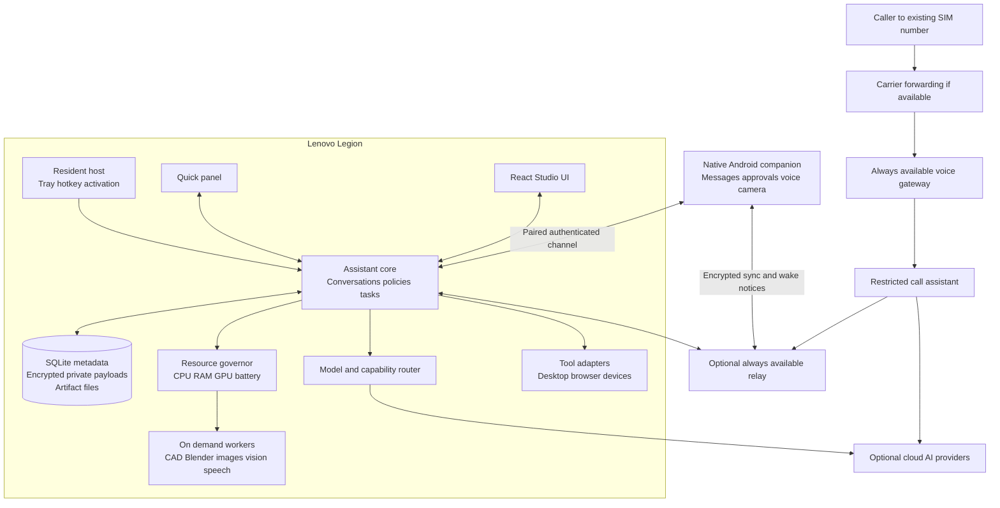

# INARA laptop and Android architecture plan

Plan date: 13 October 2026; implementation sequence reconciled 14 October 2026; call-only priority clarified 20 October 2026. Intended devices: a Lenovo Legion laptop running Windows and a Samsung Galaxy Z Fold8. Exact laptop GPU, VRAM and RAM remain to be detected. Preserve the existing SIM number and personal WhatsApp account. The current implementation findings are in [INARA project review](PROJECT_REVIEW.md). The detailed organization and interface work is in [Code cleanup and JARVIS interface plan](UI_AND_CODE_CLEANUP_PLAN.md), with a scoped next task and model recommendation in [Implementation handoff](IMPLEMENTATION_HANDOFF.md).

Build INARA as a lightweight resident assistant with a full creative workspace and an Android companion. Use local processing for activation, routine actions, private memory and tracking. Offer cloud assistance for complex reasoning, higher-quality generation and telephone conversations. Start heavy local workers only when requested, and let the resource manager defer them while gaming or on battery.

Keeping the existing phone accounts is a product requirement. The intended Android baseline includes owner-approved personal WhatsApp notification summaries. Reply drafting and sending are deferred capabilities, invoked only by a specific owner request; receiving a message never starts a reply. General AI conversations on SIM calls require a validated carrier-forwarding path or a supported OEM integration. General AI answering of personal WhatsApp calls is a feasibility constraint, not a committed feature.

## Product behavior

| Mode | User experience | Resources and lifetime |
| --- | --- | --- |
| Resident | Tray icon, hotkey, optional local wake phrase, reminders and paired-phone events | Small service persists when windows close. No large language model, camera or creative worker stays loaded by default. |
| Quick assistant | Small chat or voice panel for opening apps, finding files, reminders, answers and message review | Start only the required speech or reasoning adapter. Return to resident mode after an idle timeout. |
| Studio | Full workspace for CAD, Blender, images, coding, browser tasks and camera tools | Workers and previews load on demand. Panel-owned jobs currently cancel when Studio closes; explicit background execution is planned. |
| Game or battery | Quiet assistant with push-to-talk or hotkey access and urgent notifications | Defer GPU generation, indexing and camera watches. Permit cloud execution when enabled. |
| Android | Chat, voice button, message inbox, approvals, call summaries, camera sharing and laptop job control | Native event-driven app. No large model or continuous camera runs in the background. |

Opening Studio exposes tools; it does not start every tool. A job launched by voice can start the same worker without opening Studio, subject to the selected resource policy. Today, closing the owning Studio/workspace cancels its creative worker and preserves prior artifacts/history. A future explicit background-job mode will keep an approved job running while releasing its preview; it must not silently retain GPU work.

Examples of the intended experience:

- During a game: “INARA, remind me in 20 minutes.” The reminder is created locally without loading a reasoning model.
- In Studio: “Design a controller stand for these dimensions.” INARA proposes parameters, builds geometry, displays measurements and saves an editable revision.
- From the phone: “Make the stand wider.” The same project opens on the laptop worker; the phone receives a preview and completion notice.
- For messages: “What did I miss?” INARA summarizes allowed notifications. It drafts a reply only after an instruction such as “Draft a reply to this message”; drafting alone does not authorize sending.
- After a forwarded call: “The courier asked for a delivery time. I used your approved delivery instructions and created a callback task.” The owner receives the actual result and transcript excerpt.

## Architecture



This is one modular application with supervised worker processes. Use a persistent local job queue; a single-user installation does not need a cluster, Redis or independently deployed microservices. The voice gateway is separate because calls must have a reliable destination when the laptop is asleep.

## Technology choices

Implementation decision, 14 October 2026: the measured Python/Win32 host meets the local idle target without retaining a webview or adding another resident runtime. Keep Electron for the on-demand Studio and defer a Tauri migration unless installation or compatibility evidence justifies it. See [native host measurements and acceptance limits](NATIVE_RESIDENT.md).

| Layer | Proposed choice | Reason and qualification |
| --- | --- | --- |
| Resident host and Windows shell | Python/Win32 tray and core; Electron 44.7.0 only for an open workspace | Measured 64.86 MB mean / 65.30 MB peak combined resident working set. Retain the tested React/WebGL workspace; Rust/Tauri remains an optional future packaging evaluation. |
| Studio UI | Reuse React and Zustand; introduce TypeScript, lazy routes and generated contracts | Preserve the visual work and Three.js viewer while reducing startup and contract errors. |
| Assistant core | Python, FastAPI and typed Pydantic requests | Reuse existing integrations, with a small import graph and no model initialization at import time. |
| Desktop transport | Native IPC to the host; authenticated loopback API for Python | No unauthenticated fixed port. Launch-scoped credentials and strict allowed origins. |
| Android | Kotlin, Jetpack Compose, Room and Android Keystore | Direct access to Android service lifecycles, notification actions and foldable layouts. |
| Data | SQLite in WAL mode, artifact directories and encrypted sensitive payloads | Transactional jobs and reminders without a separate database service. SQLite itself is not automatically encrypted. |
| Local reasoning | Managed llama.cpp process; optional Ollama adapter | Start and unload models explicitly, with bounded context and a tested tool schema. |
| Local speech | Evaluate sherpa-onnx for streaming speech, VAD and keyword detection; retain a working wake-word adapter where useful | Choose models through accuracy and resource measurements on these devices. Runtime and model licences are separate. |
| Mechanical design | Implemented bounded stdlib mesh worker; build123d remains a future engineering adapter | Offline parametric box/bracket/enclosure with validated STL/GLB now works. Add richer geometry and STEP through an isolated kernel later. See [CAD Studio](CAD_STUDIO.md). |
| Artistic 3D | Blender worker plus a small Blender integration for approved scene operations | Edit objects, materials, lighting and procedural scenes while preserving native project files. |
| Image generation | Implemented on-demand local Diffusers adapter; cloud/other local engines remain optional future adapters | SD/SDXL plumbing and Image atelier are implemented. No weights were installed; actual inference, quality and GPU recovery await setup. See [Image atelier](IMAGE_ATELIER.md). |
| Tracking | MediaPipe or equivalent compact ONNX models | Local hand, face and pose landmarks without continuously invoking a multimodal cloud model. |
| Remote connection | Paired TLS channel on LAN; optional encrypted relay or private VPN for remote use | Avoid exposing the desktop automation API directly to the internet. |

Tauri uses an OS webview and supports external sidecars. That makes it a sensible candidate for this design, but memory and media compatibility still need measurement with this UI and Python service. [Tauri architecture](https://v2.tauri.app/concept/architecture/), [Tauri sidecars](https://v2.tauri.app/develop/sidecar/).

llama.cpp provides a local inference runtime. sherpa-onnx supports local speech capabilities and Android among its targets. These are candidate runtimes, not promises about the speed or quality of a particular downloaded model. [llama.cpp project](https://github.com/ggml-org/llama.cpp), [sherpa-onnx project](https://github.com/k2-fsa/sherpa-onnx).

Resolve supported stable dependency versions when implementing each phase and lock the tested versions. Maintain a model compatibility manifest and worker environment locks. Upgrading every library to its newest major version in one change would obscure compatibility failures.

## Core services and contracts

The assistant core should contain a conversation service, deterministic command router, policy service, tool registry, job scheduler, artifact service, memory service, device registry and sync service. Speech, camera, desktop control and creative tools are adapters to these services.

Every input becomes a request containing `request_id`, authenticated `principal_id`, `device_id`, `conversation_id`, optional `project_id`, modality, deadline and data-sharing policy. A model can propose a tool action, but the core decides whether it is authorized. UI buttons, voice, Android and remote calls use the same dispatcher.

Each tool declares an input/output schema, scopes, side effects, allowed project roots, execution location, deadline, cost class and resource requirements. Use explicit permission values such as `deny`, `ask` and `allow_within_scope`; the current boolean means “requires confirmation” and is too easy to misinterpret.

Jobs have durable states: `queued`, `waiting_for_approval`, `waiting_for_resources`, `running`, `succeeded`, `failed` and `cancelled`. Retriable work gets a bounded retry count. Recovery after a crash distinguishes safe regeneration from external actions whose result is unknown. Never automatically replay a message send, call placement or print start because an acknowledgement was lost.

An event envelope includes schema version, event ID, request/job ID, device, conversation, project, timestamp and payload. Clients reconnect with an event cursor and receive a state snapshot plus later events. Keep Socket.IO as a temporary legacy bridge, then introduce versioned APIs such as:

```text
POST /v1/conversations/{id}/messages
POST /v1/jobs
GET  /v1/jobs/{id}
POST /v1/jobs/{id}/cancel
POST /v1/approvals/{id}/decision
GET  /v1/artifacts/{id}/content
GET  /v1/capabilities
WS   /v1/events
```

Audio uses a transport appropriate to the provider and client. Cloud browser/mobile voice can use WebRTC, while server audio bridges may use WebSockets or SIP. Tool execution and credentials remain in the controlled backend. [Official OpenAI documentation on WebRTC](https://developers.openai.com/api/docs/guides/voice-webrtc), [server controls](https://developers.openai.com/api/docs/guides/voice-server-controls).

## Resource management

The numbers below are proposed acceptance budgets, not measurements of the existing app. Record actual aggregate process working sets, private memory, CPU time, GPU allocations and battery behavior on the Legion before committing the defaults.

| Situation | Initial target | Policy |
| --- | --- | --- |
| Resident with hotkey only | At most 150 MB aggregate RAM; average CPU below 1% over ten idle minutes | No webview, local language model, webcam or creative worker |
| Resident with local wake detection | At most 250 MB aggregate RAM; average CPU below 2% | Only compact activation runtime; no continuously open cloud audio session |
| Quick panel without a local reasoning model | At most 400 MB aggregate RAM | Minimal renderer; speech starts as needed |
| Studio without a large preview or model | At most 800 MB aggregate RAM | Lazy tools and demand-based rendering |
| Gaming | No discrete-GPU model allocation by the resident assistant | Queue heavy work; avoid overlays or process injection into games |
| Local generation | One substantial GPU job by default | Admit only when measured free VRAM and RAM satisfy the workflow plus reserve |
| Camera | Off until requested | Start with 720p capture and 10–15 tracking updates per second; raise only when needed |

Distinguish hotkey responsiveness from model cold start. Target panel visibility below one second and deterministic action acknowledgement below 500 ms under normal idle load. Measure voice response latency separately for warm local, cold local and cloud routes. Loading a local model can add several seconds; the interface should show this state and permit a different route.

At installation, detect CPU, RAM, GPU/VRAM, driver, available disk and power settings. Benchmark a small task rather than using “Legion” as a hardware specification. Suggested starting profiles:

| Available hardware | Initial local strategy |
| --- | --- |
| 16 GB RAM and roughly 4–6 GB VRAM | A 2–4B quantized model on demand; cloud for difficult reasoning and most images; CPU CAD; small scenes |
| 32 GB RAM and roughly 8 GB VRAM | Test a 7–8B quantized model with bounded context; unload it before image generation; sequential creative tasks |
| 32–64 GB RAM and 12–16 GB VRAM | Evaluate larger models or higher-quality image workflows, still with explicit admission control |

These are starting heuristics. Model architecture, quantization, context cache, image resolution and other applications all change memory use. A four-bit 8B model has roughly 4 GB of raw weight data before quantization metadata, caches and runtime overhead; it is not a 4 GB total-memory promise.

The governor grants leases for GPU and high-memory jobs, using actual free capacity rather than just installed capacity. Reserve headroom for Windows and foreground applications. On game start, unload INARA-owned idle models and defer new heavy jobs. An active job pauses at supported checkpoints or is cancelled explicitly; arbitrary kernels cannot always be suspended safely. After work, request worker unload and terminate the worker if it retains allocations. Release leases only after confirmed exit or measured release.

On battery or thermal pressure, reduce capture frequency and inference threads, suspend indexing and prefer approved cloud routes. Keep configurable model disk quotas and an offline cache. Do not silently download tens of gigabytes or keep several inference stacks resident.

## Reasoning and voice

Use three decision levels. A deterministic router handles recognized local commands. A small local model handles conversational assistance and modest tool selection. A cloud specialist handles difficult code, complex planning or multimodal requests when the selected privacy and spending policies permit it.

Route by task capability, context size, latency target, local resource availability and cost. The router must be able to say that a requested offline task exceeds available capacity. Store model IDs, supported modalities, tool behavior, fallback order and context limits in configuration. Test provider access and schema compatibility instead of scattering provider-specific code through agents.

As a current migration starting point, Google's catalog identifies `gemini-3.8-live` for the old live-audio path and `gemini-3.8-flash` for several retired general-purpose paths. Treat CAD coding, browser control and images as separate evaluations; changing a model string does not preserve an old computer-use schema. [Gemini model migration schedule](https://ai.google.dev/gemini-api/docs/deprecations).

Voice activation should happen locally. After wake or push-to-talk, open the chosen local or cloud session, retain a short in-memory preroll and support interruption. When the session ends, disconnect cloud audio, discard preroll and return to wake-only mode. Local STT/TTS must be real implementations; the current modules named `stt` and `tts` largely process transcripts and audio from a provider.

Use stable audio-device identifiers and a validated mapping between browser and native audio devices. Handle headset changes, Bluetooth switching, sleep/resume and missing microphones. One audio manager owns the room microphone and speakers. Phone call media remains separate from room audio. Add acoustic echo handling and bounded audio queues.

Evaluate speech with fan noise, game audio, headset use, English and Malay, and any additional languages selected by the owner. Start with hotkey/push-to-talk as the reliable path. A custom “Hey INARA” detector needs its own evaluation; the current archived detector uses a Jarvis wake model as a proxy.

## Creative workspace and feature priorities

| Capability | First useful release | Later additions |
| --- | --- | --- |
| Daily assistant | Local reminders, app launching, selected-file search, chat, voice and task history | Calendar/email connectors, document explanations, bounded routines |
| Mechanical CAD | Prompt plus parameters, editable model, dimensional validation, STEP/STL export, revisions | Assemblies, tolerances, constraints and comparisons |
| Artistic 3D | Blender objects, materials, lights, procedural scenes, `.blend` and GLB export | Geometry Nodes workflows, animation, rigging and evaluated image-to-3D services |
| Images | Reference images, generation/editing, masks, variant gallery and artifact history | Local ComfyUI workflows, upscaling and controlled reusable styles |
| Camera | Local hand/pose tracking and selected-frame questions | Motion-triggered watches, user-defined zones, calibrated control and phone camera input |
| Browser and desktop | Selected-app context, Playwright tasks, structured actions and previews | Vetted application adapters and scoped MCP connectors |
| Devices and printing | Working Kasa/HA aggregation and validated OctoPrint/Moonraker workflows | Capability-tested printer adapters and richer automation |
| Android communications | Allowed notification summaries, approvals and missed-call tasks | Replies only on specific owner request; carrier-forwarded conversational calls where validated |
| Memory | Project retrieval, explicit preferences and editable facts | Retrieval across approved collections and reviewed routine suggestions |

Make the JARVIS visual identity the primary interface: a dark instrument-panel layout, cyan HUD accents, a responsive voice core and meaningful activity transitions. Use a compact quick panel and a dockable Studio workspace with project navigation, a conversation/task column and an artifact canvas. Provide Chat, Create, Vision, Inbox, Devices and Jobs destinations. A persistent status area shows local/cloud execution, microphone/camera activity and the current job. The [interface plan](UI_AND_CODE_CLEANUP_PLAN.md) specifies layout behavior, design tokens, accessibility and performance gates.

Use progressive previews and an understandable activity log: planning, building, validating, rendering and saving. Do not make provider internal thoughts a product dependency. Show the result, errors and retry reasons. Include cancel, undo, compare revisions, open in the native app and export controls. Stop animations and Three.js rendering when the view is hidden.

## 3D model vibe coding

Mechanical CAD and artistic meshes need different pipelines. Ask only for dimensions or constraints that materially affect the result. An artistic mesh from text or an image does not establish manufacturing accuracy.

For CAD, the model produces a structured design specification: units, named parameters, primitive/sketch operations, constraints, feature IDs and expected dimensions. A trusted adapter turns allowed operations into build123d geometry. Validate bounds, solid validity, expected volumes, clearances and export success. Save the specification, source generated by the trusted adapter, an editable STEP artifact, STL where needed, preview renders and a validation report. build123d supports STEP and mesh export formats. [build123d import and export documentation](https://build123d.readthedocs.io/en/latest/import_export.html).

For Blender, use a scene operation schema with persistent object IDs, meshes, transforms, materials, lights, cameras and a restricted node library. Start with coarse geometry and a fast preview. Render several views and inspect the output before final export. Preserve a `.blend` project and GLB for the viewer. Later support topology checks, UVs, rigging and image-to-3D adapters after measuring quality, licence terms and costs.

Each iteration modifies a revision rather than rewriting a single shared `current_design.py`. Use unique job directories and revision ancestry. An instruction such as “increase the height to 140 mm” updates one parameter; “add a hole here” can reference a selected feature and coordinate system. Measure the rebuilt object against the request before announcing success. Repair attempts stop after a bounded number of iterations and preserve the last valid artifact.

Run previews with capped resolution, samples and scene complexity. Rendering may need GPU resources while CAD construction can usually proceed on CPU. Raw Python scripts are an advanced capability, requiring a verified restricted execution environment. A subprocess or AST filter alone is not a security sandbox. Prefer the operation schema on machines without a suitable isolated execution option.

The print workflow is a separate sequence: validate model, choose a saved printer/material profile, slice, show an estimate, upload, then start after the configured approval. Preview generation must not implicitly start a physical print.

## Images and camera tracking

Add image generation through a common job/artifact interface. Cloud generation is the initial high-quality path; local generation is an optional download and worker. Store prompt, referenced artifact IDs, dimensions, seed where supported, workflow/model versions and outputs. Editing retains the original and saves a new revision.

ComfyUI exposes workflow submission, queue/history, progress events, interruption and model unloading. Wrap only approved workflows and reviewed node sets in a local adapter. Custom nodes are executable extensions and require version control and isolation from the core. Keep its server on loopback and do not expose its API as the phone endpoint. [ComfyUI server routes](https://docs.comfy.org/development/comfyui-server/comms_routes).

The camera service owns acquisition and shares a frame buffer with subscribers. Tracking consumes low-resolution local frames; semantic vision receives only the frame or region needed for the user's question. Use one acquisition path for the selected camera, timestamp every frame and reject stale inputs after disconnects. Phone camera streaming is foreground and visibly enabled.

For watches, run a cheap local trigger first, then an optional semantic check. Add minimum confidence, persistence across frames, cooldown and a clear “camera unavailable” state. Avoid treating an API error or missing key as proof that a condition is absent. Gesture control needs calibration, smoothing and activation/deactivation controls. Face tracking can support presence or avatar motion without being used to authorize sensitive tools. [MediaPipe hand landmark guide](https://developers.google.com/edge/mediapipe/solutions/vision/hand_landmarker).

## Android companion and personal WhatsApp

Build a native companion rather than wrapping the desktop web app. On the Fold8 cover screen, show a compact conversation and action inbox. When unfolded, use list/detail panes for messages, job previews or project control. Preserve state across folding, resizing and multi-window use. Android's adaptive Compose APIs support window-size and posture-aware layouts. [Android adaptive app guidance](https://developer.android.com/develop/ui/compose/layouts/adaptive/get-started-with-adaptive-apps).

The first Android release should support paired-device chat, push-to-talk, local reminders/notes, artifact previews, approval cards, approved notification ingestion and camera sharing while the app is visible. WhatsApp reply drafting and sending are excluded from the initial release and can be added only following a specific owner request to implement them. Use event-driven services and scheduled background sync. Push notifications can announce available encrypted data; they should not contain private message bodies. A persistent socket is appropriate while the app is active, not a guarantee of background delivery.

Android restricts background service and microphone starts. Use explicit foreground sessions with visible indicators when required; do not promise an unrestricted always-listening phone assistant. [Android foreground service restrictions](https://developer.android.com/develop/background-work/services/fgs/restrictions-bg-start).

Personal WhatsApp assistance should use owner-enabled notification access. `NotificationListenerService` can receive posted notifications. Keep reply actions outside the initial implementation. If the owner later specifically requests reply functionality, evaluate `RemoteInput` on the actual Fold8; a particular WhatsApp version, notification or phone state may not expose a usable reply action. [Android notification listener](https://developer.android.com/reference/android/service/notification/NotificationListenerService), [Android RemoteInput](https://developer.android.com/reference/android/app/RemoteInput).

The proposed message flow, including the deferred reply capability, is:

1. Receive a notification only from an allowed app/conversation. Normalize sender, time and visible text; deduplicate grouped notification updates.
2. Apply sensitive-content rules locally. Exclude OTPs and avoid forwarding private groups by default.
3. Summarize recent captured context through the chosen approved route. A summary request does not authorize a draft or a send.
4. Once reply functionality has specifically been requested and implemented, draft only in response to a direct owner instruction identifying the message or recipient. Draft-only instructions keep sending disabled. A send instruction must identify the recipient and final text, or refer unambiguously to the reviewed draft.
5. For an explicitly authorized send, validate the recipient and action at execution time. Use a still-valid reply action if supported; otherwise open the messaging app for the owner to send. Record the outcome as submitted, confirmed or uncertain according to available evidence. Never resend automatically after an ambiguous result.

This captures notifications, not complete chat history. Messages may be unavailable when previews are hidden, WhatsApp is foreground, notifications are suppressed, or an action expires. A new conversation or media message may require opening WhatsApp. Voice notes need an explicit share/import workflow. Automatic replies and acknowledgements are excluded. Incoming notifications, reminders, scheduled routines, generic requests for help and a previously approved reply cannot authorize a new reply. The core enforces this policy independently of model instructions.

Personal WhatsApp calls remain with WhatsApp. INARA can present missed-call information when available and offer a callback task. Meta describes its calling API as a capability of the WhatsApp Business Platform. That does not establish an API for answering arbitrary calls on the owner's personal account, so this plan does not depend on one. [Meta WhatsApp Calling API](https://developers.meta.com/resources/videos/whatsapp-calling-api/).

Business calling can be a later alternative if the owner changes the account requirement. Validate business registration, number eligibility, regional availability and calling permissions before proposing migration. Do not move the personal account as part of this revamp. [Twilio WhatsApp Business Calling requirements](https://www.twilio.com/docs/voice/whatsapp-business-calling).

## SIM calls while keeping the number

An ordinary Android app can screen calls, but the documented call-audio capture path requires privileged pre-installed access. Becoming a default dialer or notification listener is not a general media bridge. [Android call screening](https://developer.android.com/develop/connectivity/telecom/dialer-app/screen-calls), [Android call audio restrictions](https://developer.android.com/media/platform/sharing-audio-input).

Samsung provides built-in call screening on supported software, with live transcripts and Text call. Validate its presence on this Fold8, firmware, language and region. It can provide useful SIM screening immediately, but do not assume third-party control or automatic transcript export to INARA. Offer a manual share/import path where the phone exposes one. [Samsung call screening](https://www.samsung.com/us/support/answer/ANS10010345/).

For a full INARA conversation using the existing SIM number, prototype conditional carrier forwarding for busy, unanswered or unreachable calls to an assistant voice endpoint. Callers still dial the original number. The media bridge terminates the forwarded leg at a programmable voice/SIP service, where INARA can receive and send audio. Twilio's bidirectional Media Streams is one candidate transport. [Twilio Media Streams](https://www.twilio.com/docs/voice/media-streams).

Carrier forwarding support, charges, forwarded caller identity, destination eligibility and number availability must be confirmed for the actual carrier. Normal answered SIM calls stay on the handset. Forwarding does not route personal WhatsApp calls, transfer SMS, or guarantee outgoing calls present the original SIM caller ID.

Avoid forwarding loops: an assistant transfer back to the same forwarded number can re-enter the assistant. Prefer handoff to an authenticated app VoIP session, another configured destination, or a request that the owner calls back. Provide a visible forwarding state and a tested way to disable it. If the assistant gateway fails, use the provider's configured fallback message or voicemail. An internet-dependent assistant cannot handle calls during a gateway outage.

The call assistant should identify itself, collect caller name and purpose, answer only from owner-approved facts, and distinguish a request from a commitment. A caller is a separate principal with access to a small public/delivery knowledge collection. Calls cannot trigger desktop execution or access the owner's private memory. Configured caller rules may create reminders or callback requests, but cannot disclose secrets or make unrestricted commitments.

Save a final result containing call ID, caller identity as reported and verified where available, reason, answers given, requests, urgency, follow-up, completion state and transcript excerpts. Deliver it to phone and laptop with clear provenance. Add interruption, timeout, DTMF where the transport supports it, human handoff and bounded call duration. Voice media has explicit codec and sample-rate metadata per adapter.

The always-available gateway can host a small call service using cloud speech and approved cached facts. It does not need the laptop GPU. Alternatively, a personally maintained always-on SIP host can own this role, with its own reliability and maintenance cost. Restrict and validate webhooks and media stream identity. [Twilio webhook security](https://www.twilio.com/docs/usage/webhooks/webhooks-security).

## Call-only completion plan, 20 October 2026

The owner now specifically requests that INARA speak with incoming callers and take a message for SIM and WhatsApp. The owner's follow-up requires **carrier independence and the existing personal WhatsApp account**. These are settled requirements, not pending carrier/account choices. This is narrower than general WhatsApp AI: no text replies, outbound calls, purchases, scheduling commitments or caller-triggered owner tools. Call implementation takes priority over the remaining creative source backlog. A [standalone one-call Windows prototype](IMPLEMENTATION_HANDOFF.md#desktop-bridge-lab-implemented-20-october-2026) is now implemented and fixture-tested; **actual live route acceptance is still pending**. Forwarding and Business API routes described elsewhere are alternatives only if the owner later changes the requirements.

### Verified boundaries and repository findings

Android `InCallService` supports default-phone UI and `Call.answer`; this does not supply a general two-way audio bridge. Android documents privileged pre-installed access for capturing voice-call audio. The normal RECORD_AUDIO permission, notification listener, call screening and a default-dialer role must not be presented as equivalent access. Whether a particular OEM integration offers more is a separate device/SDK investigation, not an assumed capability. [Default phone application](https://developer.android.com/develop/connectivity/telecom/dialer-app), [Audio sharing](https://developer.android.com/media/platform/sharing-audio-input).

Meta describes calling as a Business Platform capability. No supported route for this owner's existing personal Messenger call media was established. API calling, number eligibility, account effects, regional availability and Business app coexistence must be checked for the actual proposed account; messaging coexistence does not prove calling support. Meta's developer pages returned rate-limit/access failures during this review, so granular current eligibility was not verified. Meta's official calling overview and AWS's own integration prerequisites establish the business-account boundary, not this owner's eligibility. [Meta Developers overview](https://www.youtube.com/watch?v=evxT7d23wx4), [AWS prerequisites](https://docs.aws.amazon.com/social-messaging/latest/userguide/whatsapp-calling-prerequisites.html).

SIM conditional forwarding is the candidate route that preserves the published number. The carrier may forward unanswered/busy/unreachable calls to a programmable voice destination; support, destination availability, identity propagation, voicemail interaction and charges depend on the carrier and service. No forwarding codes or settings should be guessed. WhatsApp calls do not enter carrier forwarding. [Twilio existing-number guidance](https://help.twilio.com/articles/223179848-Using-a-non-Twilio-number-as-the-caller-ID-for-outgoing-calls).

Source inspection: `backend/telephony/` contains old Twilio/PJSIP and Gemini Live prototypes; `backend/agents/phone_agent.py` is instantiated by archived `backend/core/server.py`. The supported composition does not expose a call service. `twilio_routes.py` currently accepts webhook/media input without signature verification, and `call_session.py` uses the general owner instruction and an old model literal. These files are design references, not a production-ready media gateway. Android has no call/dialer service, and JDK/Gradle/ADB were not found on PATH. No APK or physical calling acceptance exists.

### Immediate proof: carrier-independent personal call bridge

Investigate two experimental routes before building the call engine. Neither is established as working in this project:

1. **Dedicated hands-free bridge:** the phone acts as Bluetooth HFP Audio Gateway; an external device implements the Hands-Free role with call control and duplex audio. Send that device's audio to an isolated INARA worker. BlueZ/PipeWire document hands-free roles on Linux, making a small bridge device a candidate. This is hardware/protocol feasibility, not a guarantee that the Fold's WhatsApp build exports ringing/answer control over HFP. Windows normally acts as the Audio Gateway for attached headsets; pairing phone and laptop alone does not turn Windows into a programmable headset. [Microsoft HFP roles](https://learn.microsoft.com/en-us/windows-hardware/design/accessory-guidelines/bluetooth-accessory-guidelines/bluetooth-accessory-guidelines-classic-audio), [BlueZ profile API](https://github.com/bluez/bluez/blob/master/doc/org.bluez.ProfileManager.rst), [WirePlumber Bluetooth roles](https://pipewire.pages.freedesktop.org/wireplumber/daemon/configuration/bluetooth.html).
2. **Scoped desktop-client bridge:** investigate Phone Link/Bluetooth for SIM and the official linked WhatsApp Windows app for personal calls. Microsoft and WhatsApp document human calling on these clients, which establishes a place to test, not an AI automation API. First prove accessible incoming-call identity/control and isolated duplex media. App UI changes, Windows lock, virtual audio endpoint/driver requirements, call routing conflicts and terms/supportability need acceptance. No session-cookie extraction, unofficial WhatsApp protocol, arbitrary screen clicking or general chat automation. Desktop controls must be constrained to the verified app/process and currently ringing call; ambiguity leaves the call untouched. [Phone Link setup](https://support.microsoft.com/en-us/windows/apps/phonelink/setting-up-calls-in-the-phone-link), [WhatsApp Windows audio requirements](https://faq.whatsapp.com/1153602608602452/?cms_platform=windows-desktop&locale=en_US).

Proof procedure: use controlled incoming calls on each channel; observe the exact ring; perform one bounded answer; play a fixed disclosed test greeting and capture a caller-spoken test phrase through isolated endpoints; verify remote audibility, echo isolation and call identity; end the call; then test disarm, lock/background, route removal, competing headset and reconnect. No model is needed to prove these fundamentals. If automatic answer fails while manually answered media works, report automatic answer as failing. If an audio endpoint contains game/other-app audio or ambient microphone rather than the caller, the proof fails. Hardware, driver installation, pairing, microphone permissions and controlled live calls must be explicitly set up rather than inferred from code.

Carrier independence means INARA integrates at the phone/client audio layer instead of a carrier API. It does not justify promising every carrier, device, firmware and app combination; publish tested compatibility. A headset/desktop bridge needs a reachable paired phone, active bridge host and working audio route. A Windows-only prototype cannot answer when the Legion sleeps; autonomous use away from the Legion would require a separately validated portable/always-on bridge or genuine OEM/platform support. No such device or route was tested in this workspace.

### Proposed runtime and source boundaries

```text
SIM call on existing number -> verified phone/headset or desktop bridge --+
Personal WhatsApp call -----> verified personal call bridge -------------+-> restricted call worker
Restricted call worker -> protected call receipt -> owner call inbox / paired phone
Desktop bridge source is implemented as an opt-in supervised CLI experiment; neither live route is verified. The [Call bridge lab](CALL_LAB.md) now provides owner/project-scoped offline checks, Stop and protected synthetic records in Command OS, with shared resource ownership and actual Windows process-tree acceptance. Live enrollment and core usage admission remain prerequisites for future live UI controls.
```

Use one inbound adapter contract with source-scoped call ID, event ID, paired device/account/process binding, codec/sample rate and a session generation. Separate `accept`, receive/send media, clear playback on interruption, `terminate` and immutable terminal receipt. Bridge validation owns exact control/media endpoint identity; the call worker owns speech/model lifetime. Neither runs inside the owner's general desktop tool dispatcher. A later gateway alternative would additionally validate webhook signatures and stream identity. No public webhook is mounted on the current private mobile listener or loopback desktop core.

A provider-specific supported implementation should live behind the core's existing service/adapter composition. Extract reusable media conversion only after independent codec tests; do not revive the archived server. Replace global model literals with a validated call-model profile and per-call usage admission. Stream audio with bounded queues and no raw recording by default. Preserve explicit format negotiation and test conversion with known audio vectors before connecting a caller.

The initial assistant is a message taker: identify itself as INARA, an AI assistant; ask the caller's name, reason, message and callback details; read back important details and close. Supplied numbers/names are caller-reported, not verified identity. It may use only a separately owner-approved greeting/public facts pack, never desktop history or private project memory. It cannot execute tools or make commitments on behalf of the owner. No model-generated follow-up is treated as an approved task.

Proposed initial limits: one active AI call, 180-second maximum, bounded transcript/turn count and configurable spend admission. These are design defaults to validate, not measured quality/latency targets. An explicit setup switch arms an incoming-call policy; matched calls then use that standing scope without requiring a click per ring. Answering is disabled until media readiness and fallback are verified. Revoke/disarm prevents new sessions; owner termination ends active media and provider work. Startup never answers an old ringing receipt or resumes an interrupted conversation.

Use explicit states `ringing -> accepting -> active -> finalizing -> completed`, with `declined`, `failed`, `interrupted` and `uncertain` outcomes as appropriate. An accept timeout is uncertain until reconciled with the provider; no blind answer retry. Provider event IDs and terminal receipts deduplicate repeated events across restart. Callback text is a captured request only; outgoing dialing remains absent. Unknown or expired streams and out-of-order terminal events cannot reopen a session. Barge-in cancels buffered assistant playback; silence, provider failure, max duration and disconnect stop all owned tasks.

### Availability, receipts and owner experience

For the selected carrier-independent/personal-account target, validate a local bridge first and label its proximity/host availability accurately. A separate always-on hands-free bridge is additional hardware with its own setup and acceptance, not a software switch. When unarmed/unready, leave the call with the existing phone/client. A failure after answer requires deterministic termination/handoff and a partial receipt. The optional carrier-forwarding gateway alternative could provide provider-side fallback, but it is not the selected architecture under the owner's latest requirements. Do not expose the resident core through a public tunnel as the production foundation.

Call receipts include a provider/source-scoped ID, timestamps, reported caller identity, caller-confirmed message, callback details, whether the message was confirmed, partial/final status, interruption/failure reason, usage and owner read state. Do not invent a complete transcript after loss. Encrypt private payloads before storage, apply bounded retention and Forget, and authenticate owner/device/project access. Cloud gateway storage cannot assume Windows DPAPI; select supported host secret storage before deployment. Sync final receipts idempotently with explicit device grants; no owner tool privileges accompany a call summary. Raw call recording is a separately chosen capability, not enabled by message taking.

Extend the current Inbox with a call source and visible answer policy/availability, distinguishing an armed route, a reachable gateway and an actually verified route. Keep personal WhatsApp's unsupported state explicit. The Android app displays delivered receipts and the real core/gateway availability; it must not claim the phone's microphone supplies SIM/WhatsApp caller audio. No message-send controls are added by this milestone.

### Acceptance and project completion order

Before live use, exercise signed/forged/duplicate/reordered webhook events; unknown account/call/stream; bounded media and codec vectors; prompt injection; no-tools/private-memory isolation; silence, interruption and ambiguous accept; budget exhaustion; restart without replay; encrypted receipt/retention; core sleep; fallback; and disarm/revoke/cleanup. Then make controlled calls through the real carrier route, verify caller experience, original-number reachability, disable/rollback, voicemail and billing. A fixture only proves software behavior. Use separate controlled WhatsApp calls only after eligibility and account consequences are accepted.

Follow whole milestones: personal/carrier-independent bridge proof -> isolated inbound adapter -> message-taking voice worker -> protected call inbox -> live SIM acceptance -> personal WhatsApp acceptance -> remaining multi-object/creative workflows -> reproducible Android/Fold and real provider/device acceptance -> signed private release/update/recovery and sustained resource checks. The detailed exit criteria are in the [current handoff](IMPLEMENTATION_HANDOFF.md#current-priority-incoming-call-answering-and-message-taking). The user-deferred real-game benchmark remains deferred. If no viable personal control/media route is proven, WhatsApp AI answering remains an unresolved product constraint; the entire dual-channel request cannot be declared complete.

## Memory security and sync

Use separate owner preferences, project memory, conversation history and tool execution records. Memories have a source, scope, creation time and optional expiry. The owner can inspect, correct and forget them. Retrieve a bounded selection of relevant material instead of concatenating every project text file into the model context.

The data model should include projects, conversations, messages, artifacts, revisions, jobs, events, approvals, devices, capability grants, reminders, call records and notification records. Save large files outside SQLite using artifact IDs, content hashes and manifests. Serve binary data or preview references instead of repeatedly broadcasting base64 assets.

Use OS-protected secret storage on Windows and Android Keystore on the phone. Encrypt sensitive stored payloads before they reach the database or WAL, and keep plaintext metadata minimal. Pair devices through a QR code, verify device identity, support revocation, expire action grants and prevent replay. Use established cryptographic libraries and protocols; do not design custom encryption. The relay carries encrypted sync payloads, while cloud AI receives only content explicitly selected for cloud execution. PSTN call media is a separate trust boundary and is not made end-to-end encrypted by the sync channel.

Every action checks its scope at execution time, including UI buttons. Confirmations bind the principal, tool, argument hash and expiry. Canonical path containment includes junction/symlink handling. Browser content, caller speech, camera text and retrieved documents are untrusted inputs; they cannot expand tool permissions. Plugins and MCP servers run under scoped grants and start only when needed.

Require explicit owner authorization for sending messages, placing calls, printing, destructive filesystem changes and similar external effects. A sufficiently specific instruction can supply that authorization; do not request it again unless the intended action changes or remains ambiguous. WhatsApp has the additional request-only policy above, with no standing automatic reply grants. Allow established low-impact routines within explicit grants. Remote callers have their own much narrower grants. Use OS authentication for sensitive owner actions, subject to hardware support; a normal webcam landmark match is insufficient.

Reminders store UTC timestamps plus an IANA timezone for calendar recurrence, with `Asia/Kuala_Lumpur` as the initial client timezone. Use transactional claiming and deduplicated delivery across phone and laptop. Configure which device owns each reminder; sync is not a licence to fire two independent notifications indefinitely. Resolve edits and deletion tombstones by record version.

When the laptop is asleep, the phone retains notes, reminders, captured notifications and approved small offline behaviors. Heavy requests queue with a visible unavailable state. A configured cloud route can answer chat or calls independently, with only the knowledge supplied to it. Do not promise immediate laptop execution or universal remote wake.

## Current baseline and implementation sequence (14 October 2026)

This sequence supersedes the initial phase/week estimates and outdated implementation assumptions in the original review. It is a dependency plan, not a delivery-date commitment. One milestone may require several bounded implementations; keep each checkpoint usable and reviewable. Feature work and refactoring advance together. Do not start another whole-project rewrite.

The current checkpoint is `5f79902`: independent typed core, private persistence/reminders, native resident, JARVIS shell, offline solids/scenes, optional fixed Blender bridge, Image atelier and shared owned creative jobs. The recorded suite has 144 Python checks and nine frontend checks passing. These counts describe the existing checkpoint, not universal coverage of every retained legacy integration. Real Blender execution, diffusion inference, phone operation and game impact remain unverified. The short image-fixture recovery observation is approximately 65 MB resident working set; the earlier ten-minute native idle evidence is separate.

At roadmap checkpoint `5f79902`, the source inventory found 145 Python/JS/JSX/CSS source files in `backend/` and `src/`, including archived modules. Current cleanup pressure points include `backend/server.py` (1505 lines), `backend/inara.py` (1403), `backend/printer_agent.py` (1092), archived `backend/core/server.py` (781), `backend/voice/pipeline.py` (733) and `src/app/workspace.css` (1769). Line counts locate ownership problems; they are not arbitrary file-size targets. Several direct legacy device, screenshot and clipboard handlers still call adapters outside the newer shared tool path. Do not expose those paths to a paired phone before migration.

### R1. Vision studio v2: implemented, hardware acceptance pending

**Implementation update:** [Vision studio v2](VISION_STUDIO.md) now implements this software scope, with real-model/synthetic-stream verification. Actual camera/hand and physical sleep/device acceptance remain pending. R2a is now implemented; R2b is next.

Product outcome: a polished camera workspace with a clear off/requesting/preview/tracking/failed state, source selection, mirror control, useful hand overlays, confidence/presence information and a visible way to stop. Begin with the existing bundled hand model. Face/pose models are later optional capabilities; landmarks do not authenticate the owner.

Refactor: separate capture ownership, tracking scheduling and overlay rendering from React presentation. Reuse `features/vision/capture.js` and the working local tracker; consolidate legacy `useVideoCapture`/`useHandTracking` only after checking their consumers. Replace duplicated acquisition/inference loops with one session controller. Evaluate a dedicated Web Worker/transferable-frame path for inference to keep the UI responsive, retaining a tested fallback if packaged WASM compatibility requires it. Never queue an unbounded frame backlog.

Acceptance: duplicate starts, slow permission completion after close, denied permission, track-ended/device-unplug, source switching, hidden view, sleep/resume and gaming all release or pause the intended resources. Verify mirrored overlay alignment and stale-frame rejection. Synthetic streams and actual renderer/model initialization checks run without taking the owner's camera; real camera acceptance remains clearly separate. No recording, frame upload or gesture-triggered desktop action is added by default.

### R2. Core composition, transport and authorization cleanup

Product outcome: one reliable capability path for typed requests, UI actions and later voice/phone actions, with useful errors and predictable reconnect/shutdown.

**R2a implementation update:** [Core composition](CORE_COMPOSITION.md) records the completed ownership extraction, native/renderer verification and remaining legacy seams. R2b route/policy migration is next.

R2a extracts construction/lifetime from `server.py` into an application composition root with explicit dependencies. Move session identity, project context and event delivery into owned services, then feature registration into transport modules. Preserve `server.py` as the compatible supported entry point. Avoid tests or adapters depending on mutable module globals or private monkey-patches in production.

R2b inventories every socket event and legacy voice tool. Define request/result/error contracts, the allowed principal/device/project scope and its side effects. Route implemented actions through the dispatcher; explicitly report unavailable where safe behavior has not been migrated. Cover device controls, clipboard/screenshot, browser, memory and printer routes as well as the newer text/reminder/creative routes. Use narrow owner rooms instead of unintended broadcasts. Approval records bind identity, tool, argument hash, project and expiry, with execution-time rechecks and no repeated permission questions for unchanged authorized work.

R2c consolidates tool declarations and provider-schema translation. Preserve the SDK schema regression checks already needed for nested scene data and image sizes. Inventory actual imports before moving active modules out of `backend/core/`; its archived server does not make the whole directory unused. Retire duplicate CAD/web/voice paths only after mapping retained behavior to their replacement and verifying compatibility.

Acceptance: a route/policy matrix has no unexplained supported bypass, cross-owner/project access fails, direct and model invocations apply the same rule, reconnection does not replay uncertain work, and current CAD/image/reminder/native checks still pass. LAN/mobile automation stays closed until this gate passes.

### R3. Typed UI contracts, shared design system and activity workspace

Product outcome: the remaining panels feel like one JARVIS application. Add a common activity view for jobs, artifacts, errors, approvals and recovery; maintain truthful state rather than decorative telemetry.

Refactor: migrate the transport boundary and new feature modules to TypeScript incrementally, allowing existing JavaScript during migration. Generate client types from authoritative Pydantic/JSON schemas and version the event contract; retain runtime validation at the core. Break `socketSubscriptions.js` into feature registrations. Share request/job/reconnect handling instead of duplicating it in CAD and images. Keep frame/audio updates out of broad Zustand subscriptions.

Extract design tokens, panel headers, labelled fields, status/progress, error/empty states, revision lists, accessible dialogs and approval UI. Split `workspace.css` by shell/layout/tokens; keep feature styles scoped. Add a keyboard command palette, consistent recovery actions and responsive master/detail layouts. Preserve real models/images as the visual focus; stop hidden animation and WebGL rendering.

Acceptance: keyboard/focus behavior, reduced motion, long text, 200% text scaling, narrow/tablet/desktop/ultrawide widths and representative Windows DPI settings work. Initial assets stay lazy and bundle regressions are visible. Existing JS can coexist; a mass rename is not a completion criterion.

### R4. Capability center, resource governor and job lifetime

Product outcome: INARA explains what is ready, missing, blocked by gaming or awaiting setup, and why a job can or cannot start. Add hardware detection, readable diagnostics and local/cloud/manual performance profiles without installing anything automatically.

Refactor: centralize configuration and capability descriptors; distinguish detected configuration, installed dependencies, verified integration and measured performance. Replace scattered model identifiers with per-capability profiles. Introduce a small reservation/queue service around the existing single creative slot: CPU/RAM/VRAM estimates, cancellation, bounded admission, fairness and explicit release. Optional hardware probes run on demand or at a low rate and show unknown when unsupported; never import Torch into the resident to detect a GPU.

Keep manual gaming mode authoritative. Automatic foreground-game detection is opt-in later and must not inject into games. Separate notifications from GPU scheduling. Add explicit foreground/background job lifetime only after reservation and reconnect tests: closing a panel cancels foreground work; the owner can deliberately run supported jobs in the background. Background work must respect gaming transitions and never cause replay of an uncertain claim. Sleep/resume produces a clear interrupted/recoverable state.

Acceptance: no worker/model/device leak, no unwanted GPU allocation in resident/gaming mode, no unbounded queue, accurate diagnostics, cancellation/retry fairness and post-worker recovery measurements. Preserve the <=150 MB / <1% CPU ten-minute resident target; compare results using the same aggregate process accounting. Existing approximately 65 MB measurements are a baseline, not a promise for future loaded models. Real-game benchmarking remains deferred.

### R5. Creative Studio v2: stronger workflows and 3D vibe coding

Status: the offline editing, branch/review, view/compare and image recipe/gallery workflow is implemented. See [R5 implementation and acceptance gates](R5_CREATIVE_STUDIO.md). Optional engineering-kernel and actual Blender/image/provider acceptance remains gated; R6 is now implemented within its fixture acceptance boundary; R7 is next.

Product outcome: edit an existing design through selection, constrained transforms, dimensions, undo/redo and revision comparison. A natural-language change should propose a validated change set against the selected revision, show its effect and build a new revision after review.

R5a improves the offline workflow: shared artifact browser, reload/duplicate recipes, numeric/gizmo transform consistency, object selection, frame-to-selection, saved views and deliberate revision branching. Preserve units, closed-part/overlap semantics and previous artifacts. Add a constrained scene-change schema with an explicit base revision; reject stale changes rather than applying them to a different design. Prompt-generated Python remains excluded.

R5b adds richer geometry only through a separately installed owned engineering adapter: supported primitives/features, holes/fillets/booleans and STEP where a validated CAD kernel is available. Check topology, dimensions, volume/units and exports with representative fixtures before exposing an operation. Existing simple solids remain independent of the kernel.

R5c expands the fixed Blender bridge with validated materials/lights/cameras/render settings and editable scene revisions. Actual import/save/render/export and Blender resource recovery require installation acceptance. Image atelier adds gallery/compare/recipe reuse first; reference images, masks, editing, upscaling, cloud engines and newer local pipelines are separate adapters with explicit availability, bounded inputs and cost/resource policies.

Acceptance: offline flows work without providers, schema-only proposals are labelled as proposals, every successful edit has validated exports, stale requests cannot corrupt revisions, and cancellation preserves the last valid artifact. Installation-independent work proceeds while configuration remains deferred. No fixture run establishes model quality or GPU fitness.

### R6. Quick assistant and voice v2

Status: implemented with synthetic media and injected provider acceptance. See [R6 behavior and remaining physical acceptance](R6_QUICK_ASSISTANT.md). Production microphone/provider/local speech quality and Bluetooth/sleep tests remain deferred.

Product outcome: a compact hotkey panel for everyday assistance, push-to-talk, streaming transcript, speech responses and interruption, with typed use always available. Add a clear listening/thinking/speaking state and device recovery. Wake-word activation is a later optional profile with its own measured idle cost.

Refactor: separate the 1403-line legacy AudioLoop into capture/device management, speech recognition, conversation integration and playback. Reconcile the separate `voice/pipeline.py` implementation instead of maintaining two authoritative voice/tool stacks. One conversation service and dispatcher serve text and voice. Explicit audio-frame metadata covers codec, sample rate, channels, sequence and timestamps; bounded queues, echo handling and interruption belong at the media boundary.

Acceptance: no microphone or cloud audio connection at ordinary text startup, duplicate sessions do not own the same device, Bluetooth/device switches and sleep/resume recover, interruption stops playback/work correctly, and closing quick UI releases speech resources. Local speech/provider configuration is optional/deferred until selected. Mock speech proves lifecycle only; real speech latency/accuracy needs owner-device acceptance. Evaluate the separate <=250 MB / <2% CPU wake-profile target only if wake detection is enabled.

### R7. Android foundation and secure pairing

Status: desktop/server pairing and native companion source are implemented. Actual loopback TLS fixtures pass; Android build/Keystore/foldable/battery acceptance is blocked by unavailable tooling and remains unverified. See [R7 source and acceptance gates](R7_ANDROID_FOUNDATION.md). R8 read-only notification source follows without enabling real phone access automatically.

Product outcome: native Kotlin/Compose companion with chat, laptop status, job previews and notifications/approvals, adapting to cover-screen, unfolded and multi-window layouts. Start with pairing and read-only job/status access; enable mutating actions only after the same grants apply on desktop and phone.

Refactor: introduce device identity and per-device/project sessions rather than exposing the desktop launch token or a global current project. Add expiring QR pairing, owner verification, established TLS/authentication, Keystore/DPAPI key protection, revocation and replay-resistant request IDs. Keep LAN operation first; private-network/relay support is a separately validated transport and never a public unauthenticated automation port. Add idempotent offline outbox/sync, not automatic replay of externally effective actions.

Acceptance: pairing/revocation, two-device scope, lost/stale approvals, disconnect/reconnect, app process death, laptop sleep/unavailability, fold/unfold and background battery behavior pass. No default-dialer role, notification permission or microphone access is silently enabled by pairing. Record the exact phone/OS and laptop specifications before hardware-specific claims.

### R8. Android notification inbox and owner summaries

Product outcome: summarize selected phone notifications, open the original app/message when a valid link exists, and create owner callback/reminder tasks. Preserve the existing SIM and personal WhatsApp account. Notification data can be incomplete or redacted; the UI must say so rather than imply full chat-history access.

Refactor: a native NotificationListenerService adapter with app/contact allowlists feeds scoped notification records. Deduplicate notification updates, respect access revocation, define retention and keep owner-controlled local/cloud summarization routes separate. No raw notification or summary may grant additional tools or impersonate an owner instruction.

Acceptance: summaries reflect captured text only, revocation stops collection/sync, grouping and reconnect do not duplicate records, locked/redacted content is represented honestly, and no notification can trigger a reply. **WhatsApp draft/send/auto-ack tools remain absent until the owner specifically requests that capability.** Android documents the notification callback surface in [NotificationListenerService](https://developer.android.com/reference/android/service/notification/NotificationListenerService).

### Follow-on work and release tracks

| Track | Scope and gate |
| --- | --- |
| Memory and recovery | Inspect/correct/forget project memory with provenance; scoped retrieval and incremental indexing; retention/archive controls; encrypted portable export and restore preview. DPAPI is user-bound, so portable backups require a separately designed recovery/key workflow using established libraries. Never test restore by overwriting the live profile. |
| Browser and desktop | Owned browser process, bounded DOM/accessibility tasks, selected-app context and permission-aware clipboard/screenshot; preserve the useful automation adapters. Browser content is untrusted and cannot authorize another action. |
| Smart home and printing | One device registry, validated Kasa/HA adapters and capability-specific errors. Separate slice, upload and start-print actions; exact printer capabilities and completion require real adapter acceptance. Split discovery, transport, slicing and monitoring from the large printer agent. |
| Phone-call feasibility | Record supported Android/OEM roles, call control and audio paths on the actual handset. Default-dialer UI/call control does not establish conversational access to SIM media. Android reserves VOICE_CALL recording for system components; do not promise that a normal companion app can tap/inject SIM or personal WhatsApp call audio. See [dialer roles](https://developer.android.com/develop/connectivity/telecom/dialer-app) and [audio-source restrictions](https://developer.android.com/reference/android/media/MediaRecorder.AudioSource#VOICE_CALL). Personal WhatsApp AI call answering stays research, not a delivery commitment. |
| Forwarded SIM pilot | If the owner later chooses a supported carrier-forwarding/OEM route, test it while retaining the existing number. An optional always-available call gateway is needed for service while the laptop sleeps; this has separate hosting/carrier dependencies. No number migration, forwarding change or live call is authorized merely by this plan. Callers receive a restricted fact/task scope, separate from owner tools; verify authenticated media/webhooks, interruption, codec conversion, bounded duration, owner handoff and final summaries before acceptance. |
| Packaging and support | Reproducible core and optional worker environments, dependency/license inventory, installer/uninstaller, signing, opt-in startup/update, sanitized diagnostics, migration rollback and interrupted-update recovery. Pilot desktop packaging after R4/R6; pilot companion distribution after R7/R8. Do not leave release engineering until every advanced feature is finished. |

Phone feasibility should be reviewed when the Android shell first exists, before substantial call-engine work. It does not wait for every memory/device feature. No model/API/Blender setup or carrier change is required to continue R1-R4. Real image/Blender/device tests remain separate acceptance tasks when their prerequisites are available.

### Rules for every implementation

1. Pick one concrete feature or refactor boundary; read its contract and preserve data/identity/native lifetime.
2. Make a source-control checkpoint, migrate one route/feature, keep a narrow compatibility adapter and remove it only after parity/reference checks.
3. Run relevant deterministic, policy and artifact checks. Add real hidden-renderer checks for changed UI/lifecycle behavior; do not repeat unrelated broad benchmarks without a reason.
4. Record actual versus fixture behavior, installed versus merely detected capabilities, resource observations and remaining limits. Tests must fail on invalid outcomes rather than swallow exceptions.
5. Visually review desktop and narrow UI; respect reduced motion, readable contrast, keyboard access and useful recovery.
6. Update handoff/status and keep the supported build usable. Do not expand remote access, add automatic replies or initialize heavy models as a side effect of refactoring.

R1 software and R2a runtime/session extraction are complete. The next bounded deliverables are R2b route/policy migration and R2c tool/declaration cleanup. R3 begins once the core contract has a stable version; it can progress by feature rather than waiting for every legacy adapter to be rewritten. This ordering brings visible improvements while preventing the mobile app from inheriting legacy coupling and policy gaps.

## Repository organization

```text
apps/
  desktop/                 React Studio and target native shell
  android/                 Kotlin companion
services/
  assistant/               Lean Python core and adapters
  relay/                   Optional encrypted sync service
  voice_gateway/           Optional externally reachable call service
workers/
  speech/                  Small local speech environment
  cad/                     build123d environment
  blender/                 Blender bridge and operation schemas
  images/                  Approved ComfyUI workflows and adapter
  vision/                  Tracking and semantic vision adapters
packages/
  contracts/               Versioned schemas and generated client types
  capability_specs/        Tool schemas and permissions
tests/
  unit/                    Pure logic and policy tests
  contracts/               Desktop Android worker and provider contracts
  integration/             Explicit API hardware and telephony tests
  scenarios/               Recovery latency and task success evaluations
docs/                      Architecture capability matrix and runbooks
```

Start by introducing these boundaries within the current folders where practical; physical file moves can follow stable contracts. Use separate locked environments for CAD, speech/vision and ComfyUI to avoid incompatible binary dependencies. Package a lean default install, downloadable feature bundles and explicit model downloads. Data belongs in a versioned user-data directory, not the source checkout.

## Validation and operating costs

Evaluate useful outcomes. Include reminder recurrence and reboot recovery, restricted paths, caller versus owner permissions, reconnect deduplication, audio changes, geometry validity, editable exports, image cancellation, stale camera frames, device failures and call interruptions. Verify that a notification or summary request cannot draft or send a WhatsApp reply, and that draft-only requests cannot send if the deferred capability is later added. Keep real API, printer and call tests opt-in. Current tests should be retained where useful, but exception-swallowing tests need assertions before they count toward a release gate.

Measure ten-minute idle runs with and without wake detection, representative gaming sessions, cold/warm activation, repeated worker start/stop and several hours of mixed use. Set regression thresholds from the Legion baseline. Include phone Doze, notification privacy settings, expired reply actions, device folding, locked-screen behavior, lost pairing and revoked permissions.

Cloud spending is optional for routine local work. Model, image and call usage must be visible by job and capped by daily/monthly policies. Telephone operation may add number rental, carrier forwarding, call minutes, AI audio and gateway hosting. Calculate budgets from current quotes and expected minutes, not a fixed invented monthly price. Model and creative bundle licences, installer signing and infrastructure maintenance also belong in the release plan.

Phase 0 should finish with recorded laptop specifications, Fold8 firmware and regional capabilities, the actual carrier and forwarding behavior, accepted cloud budget, languages and the first three representative CAD/image/message tasks. Those facts determine the tested default profile while preserving this overall architecture.

R2b1 update: the [complete route inventory](ROUTE_POLICY_MATRIX.md) and [first desktop/device policy group](ROUTE_POLICY_MIGRATION.md) are implemented. R2b2 settings/permission/native-resource policy is next; remaining legacy groups and R2c are still pending.

R2b2 update (16 October 2026): [owner settings and lifecycle policy](SETTINGS_LIFECYCLE_POLICY.md) now separate authorization, validation, atomic settings and native/resource controls. Kasa/printer compatibility is the next bounded R2b3 group; other pending matrix rows and R2c remain open.


## Current R8 / post-revamp checkpoint

R1-R8 source milestones are implemented within their documented offline/fixture boundaries. [R8](R8_NOTIFICATIONS.md) adds selected read-only notifications without WhatsApp reply/action execution. [Release readiness](RELEASE_READINESS.md) and [machine-readable gates](RELEASE_GATES.json) supersede historical next-step notes above: Android compilation/device acceptance, self-contained signed distribution/update recovery, long-run hardware acceptance and the advanced memory/automation/device/budget backlog remain open. Offline support inventory and source-pilot integrity staging are implemented; no installer/APK/real notification acceptance is claimed.


## Project memory checkpoint after R8

The first post-revamp project-memory implementation is complete within the limits in [Project memory](PROJECT_MEMORY.md): protected owner/project collections, editable provenance, local lexical retrieval, explicit assistant sharing, retention/archive/forget and reviewed same-profile backup/recovery. Embedding semantics and portable cross-account key recovery remain future enhancements. The next source milestone is per-request/job usage budgets and task-quality evaluations; the existing release/device/configuration gates remain open.


## Usage and quality checkpoint

The second post-revamp source milestone is implemented: [Usage and quality](USAGE_AND_QUALITY.md). Conservative owner-wide admission allowances, metered provider/local-job receipts and 12 offline contract evaluations work without provider configuration or model downloads. Actual invoices/model quality remain unverified. Browser/desktop task ownership and device/printing adapter modernization are next; existing Android, signing, packaging, hardware and WhatsApp/call boundaries remain unchanged.

## Post-revamp read-only research update

The owned Web inspector and printer-observation cleanup source milestone is implemented. The autonomous browser loop is retired; public HTTPS text inspection is typed, approved, bounded, cancellable and inert. [Evidence and limits](BROWSER_INSPECTOR.md). Reviewed desktop task queues and interactive action policies remain future source work, with actual provider/hardware/Android/distribution acceptance separately gated.

## Post-revamp reviewed task update

The finite reviewed desktop task queue is implemented: immutable project file/app plans, forced per-step owner review, protected receipts before effects, cancellation and recovery without replay. [Evidence and boundaries](REVIEWED_TASKS.md). Provider planning, script execution and browser actions are not enabled by this milestone. Device/printer protocol decomposition and Connections readiness are next; live hardware/provider, Android and distribution acceptance stay separately gated.

## Post-revamp connection adapter update

Kasa/printer network adapters and metadata-only Connections readiness are implemented with injected and native UI acceptance. Exact host:port targets, saved credentials and print-stage receipts are preserved; discovery no longer probes cameras/protocols and uploads do not fall back or start prints. [Implementation and physical-acceptance limits](CONNECTION_ADAPTERS.md). Typed multi-object AI scene proposals are the next source milestone; actual SDK/providers/hardware, Android and signed distribution stay gated.
