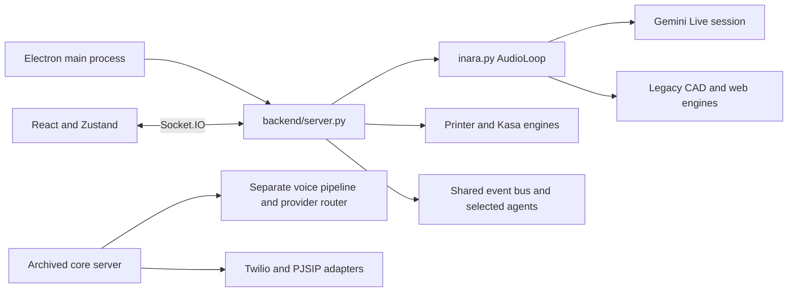

# INARA project review

Review date: 13 October 2026. Project root: the inner `INARA-main` directory. The proposed replacement architecture is in [INARA revamp plan](INARA_REVAMP_PLAN.md). See the [code cleanup and JARVIS interface plan](UI_AND_CODE_CLEANUP_PLAN.md) and [implementation handoff](IMPLEMENTATION_HANDOFF.md) for the next implementation work.

INARA has reusable integrations and a substantial desktop prototype. Its central limitation is that assistant reasoning, audio, tool execution and desktop lifetime are coupled. A lightweight resident assistant and a phone companion need a shared task service that works independently of voice and independently of an open window.

## Project coverage

The snapshot contains 149 files, including 79 Python files, 27 JavaScript files and 20 JSX files. Python accounts for 16,654 physical lines; JavaScript, JSX and CSS account for another 5,367. There are 58 backend Python files and 85 functions named as tests across the Python inventory. These counts include archived code and development helpers, not just the supported application.

The review covered the file inventory, entry points, dependencies, frontend state and transport, each backend subsystem, the archived architecture and test organization. All 79 Python files passed standard-library AST parsing. Focused offline checks reproduced the reminder state issue and verified missing phone handlers and the relative path escape. No API calls, real calls, printer actions or camera sessions were initiated.

The available environment has Python 3.12.10 but no Node executable on PATH or at the two usual installation locations checked. Pytest and the main application dependencies are absent. The full test suite, frontend build and interactive application were therefore not run. Syntax parsing does not establish runtime correctness. This downloaded snapshot has no Git metadata or CI configuration.

## Supported runtime

`electron/main.js` launches `backend/server.py`. The active server imports helpers from `backend/core/` and selected agents, but `backend/core/server.py` itself is explicitly archived and requires an override to launch. These are different facts: the core folder is partially used; its replacement server is not the supported runtime.

## Findings and consequences

| Priority | Finding | Evidence | Consequence and proposed treatment |
| --- | --- | --- | --- |
| P0 | Cloud model configuration needs urgent migration | Model literals in `cad_agent.py`, `web_agent.py`, `vision_loop.py`, `vision_agent.py`, `screen_capture.py` and `inara.py` | Move model selection into validated provider profiles and verify account access before restoring each feature. |
| P0 | Generated CAD code runs with the application's user privileges | `CadAgent.generate_prototype` invokes the current Python interpreter on a model-generated script; this path has no subprocess timeout | Use validated CAD operations by default. Isolate any unrestricted scripts outside the core service with bounded execution and restricted access. |
| P0 | A relative write path can leave the project | `AudioLoop.handle_write_file` appends an unvalidated relative path to the project directory | Resolve canonical paths and enforce containment, including Windows junctions and symlinks. Do this in the shared tool service. |
| P0 | Permissions and authentication are not consistently enforced | The voice tool loop requests confirmation, while direct handlers such as `launch_app` and `generate_cad` dispatch separately; Socket.IO has wildcard origins and no paired-client token | Route every action through the same authorization service. Loopback binding limits exposure but does not replace authentication. |
| P1 | Typed interaction depends on the live audio session | `server.user_input` requires `audio_loop.session`; direct CAD handlers require `audio_loop.cad_agent` | Introduce an independent conversation and task service. Microphone permission or voice failure must not block text and CAD. |
| P1 | The phone UI is ahead of the supported backend | `PhoneWindow.jsx` emits phone actions, but the active server lacks `answer_call`, `reject_call` and `make_phone_call`; wiring exists in the archived server | Treat telephony as prototype source material. Do not describe it as working SIM or WhatsApp integration. |
| P1 | Reminder polling repeatedly selects the same due item | `_check_reminders_loop` emits every ten seconds without calling `mark_triggered` or rescheduling; `get_due_reminders` only returns pending items | Add transactional state transitions and idempotent delivery. Store recurrence with explicit timezones. |
| P1 | Unsaved temporary work is deleted on initialization | `ProjectManager.__init__` recursively removes `projects/temp` | Migrate to recoverable sessions, explicit cleanup and retention periods. Preserve existing work before imports or migration. |
| P1 | Desktop close ends the assistant | Electron quits after its last window closes and kills the Python process tree in `will-quit` | Separate resident service lifetime from UI lifetime, with an explicit Quit assistant action. |
| P1 | Device aggregation is disconnected in the active runtime | `DeviceAgent` is constructed with both `kasa_agent=None` and `ha_bridge=None`, and no working injection follows | Reuse the existing integrations behind one device capability service. |
| P1 | Face landmarks are being treated as authentication | `FaceAuthenticator` compares landmark vectors using cosine similarity; the active capture loop requests the macOS AVFoundation backend | Use OS authentication for authorization. Keep landmark processing for optional presence and gestures. Correct platform camera handling separately. |
| P1 | Phone media formats are inconsistent | The abstract provider contract describes PCM; `CallSession` assumes 8 kHz mu-law while PJSIP exchanges PCM | Give audio frames explicit encoding, sample rate, channels and sequence metadata. Convert at provider boundaries. |
| P1 | Archived call sessions do not dispatch model tool calls | `CallSession._handle_responses` handles audio and transcripts, with no tool-call dispatcher | Add a restricted caller tool service, separate from the owner's tools. |
| P1 | Telephony webhook code lacks visible signature checks | `create_twilio_router` accepts incoming requests and a media WebSocket without validation | Validate provider signatures and bind stream identity to a known call before using this code externally. |
| P2 | Heavy dependencies are imported early | `server.py` imports `inara`, which imports OpenCV, PyAudio, image capture and CAD/browser modules; the Google client is created at module scope | Split dependency bundles and initialize providers and workers only when required. |
| P2 | Frontend work starts before its feature is requested | App statically imports feature windows; the hand hook initializes its GPU model on mount and loads WASM from a CDN | Lazy-load windows and tracking. Bundle version-matched assets for offline installation. |
| P2 | Camera and scene data have avoidable transport overhead | The camera hook acquires up to 1080p, resizes/transmits frames, and CAD results are transported as base64 STL | Use adaptive capture and binary artifact delivery. Keep tracking local and send selected frames only for semantic questions. |
| P2 | Session state is global | A single audio loop, current project and authenticator serve clients, with many broadcasts outside client rooms | Introduce owner, device, conversation and job identities before connecting a phone. |
| P2 | Dependency management is uneven | Frontend has a lockfile; Python requirements are mostly unbounded and combine CAD, vision, telephony and voice | Adopt locked dependency groups and tested worker environments. Upgrade supported versions in stages. |
| P2 | Tests do not establish end-to-end feature correctness | Several tests assert method presence; some generation tests catch exceptions and only print; hardware and API tests skip conditionally | Separate deterministic tests from opt-in integrations and add artifact, permission, recovery and resource assertions. |
| P2 | Printer coverage is overstated | Discovery includes PrusaLink, but `upload_gcode` dispatches only OctoPrint and Moonraker | Advertise capabilities per adapter and validate upload before claiming complete support. |

The provider's current schedule lists past shutdown dates for `gemini-3-pro-preview` (9 March 2026), `gemini-2.0-flash` (1 June 2026) and `gemini-2.5-computer-use-preview-10-2025` (28 July 2026). It lists 17 November 2026 as the earliest shutdown for the native-audio preview used here. Account-level endpoint behavior still needs an integration check. [Google Gemini deprecations](https://ai.google.dev/gemini-api/docs/deprecations).

## Subsystem disposition

| Subsystem | Preserve | Rework or replace |
| --- | --- | --- |
| Desktop UI | React components, Zustand slices, Three.js viewer and visual identity | Responsive workspace layout, TypeScript contracts, lazy mounting and a lightweight launcher |
| Electron | Useful bootstrap and backend identity probe | Supported dependencies during transition, finite startup timeouts, graceful shutdown, protocol restrictions; benchmark Tauri as the target shell |
| Voice | Transcription delta handling, interruption concepts, wake-word experiments | Session lifecycle, real STT/TTS adapters, audio-device identity, local wake service and independent text routing |
| CAD | build123d experience, generation retries, preview and iteration ideas | Structured design representation, isolated execution, editable geometry, revisions and geometry validation |
| Browser | Playwright integration and update callbacks | Prefer DOM/accessibility operations, bounded tasks and shared permissions; add visual control only when necessary |
| Printing | Slicer discovery, profiles, printer discovery, polling backoff, OctoPrint and Moonraker adapters | Artifact-based paths, explicit slice/upload/start stages, capability checks and supported adapter tests |
| Smart home | Kasa operations and Home Assistant bridge | Correct injection, device identity and one policy-controlled action path |
| Vision | MediaPipe tracking and watch concepts | Separate capture/tracking/semantic vision, local detection, fresh-frame checks, watch cooldowns and on-demand processing |
| Memory | Existing project folders, JSONL chat and CAD outputs | Non-destructive migration, retrieval, retention, provenance and a transactional metadata store |
| Reminders | Store model and scheduler tool definitions | Exactly-once user-visible behavior through state changes and deduplication, recurrence and reboot recovery |
| Telephony | Provider interfaces and call-session separation as design references | Verify each adapter, fix audio contracts, authentication, interruption, tool routing, caller scope and final summaries |
| Android | No Android application exists in this snapshot | Build a native companion, starting with real-device notification ingestion; replies are deferred until specifically requested |
| Image creation | No dedicated generation subsystem exists in this snapshot | Add an optional cloud adapter and an on-demand local ComfyUI worker |
| Development helpers | Useful CUDA, CAD and device diagnostic scripts | Move manual diagnostics out of default test discovery and release artifacts; do not treat randomized development helpers as verification |

## Verification performed

The offline reminder check loaded only `reminder_store.py` into an isolated temporary directory. A reminder due in the past appeared in two consecutive polls. Calling `mark_triggered` removed it from due selection. AST inspection confirmed the active polling loop never performs that transition.

AST inspection confirmed that the three phone handlers above are absent from the supported server. A path-only check showed that joining `../../outside.txt` to a project root resolves outside that root, matching the missing containment check in the write implementation. No escape write was performed.

These findings support a staged replacement of the orchestration and lifecycle layers while retaining integrations behind adapters. Switching the launcher to the archived server would expose a different, insufficiently validated application contract and would not solve the resource or Android constraints.
