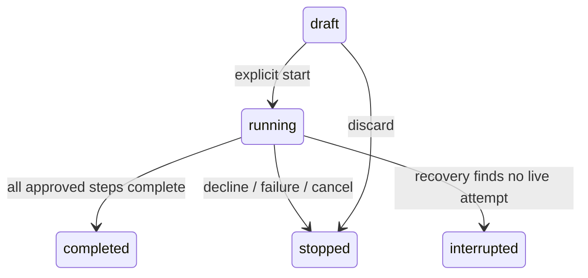

# Reviewed desktop tasks

Implemented 19 October 2026. Reviewed tasks is a manual, finite workflow queue using existing typed desktop dispatcher operations. It is not an autonomous planner, shell executor or background scheduler.

## Using the workspace

Open **Reviewed tasks** from the command workspace or command palette. Build one to eight steps, save the immutable plan, select it in Plans & receipts and choose **Review & start**. Saving never executes actions. Each step requests owner approval, including when that tool is otherwise allowed within scope. Decline or stop ends the attempt. Stopped, interrupted and completed attempts cannot be resumed/replayed; inspect the results before deliberately creating a new plan.

Supported steps:

| Step | Input | Result |
| --- | --- | --- |
| Read project file | Relative path in the captured project | Shared UTF-8 read, up to 200,000 bytes; first 4,000 characters retained as an encrypted preview |
| Write project file | Relative path and up to 16,000 characters | Shared project-contained write; replaces the file after approval; no rollback or atomic-write guarantee added |
| Open registered app | notepad, calculator, paint, explorer or vscode | Existing app registry launch; no user-supplied commands, arguments or executable paths |

The complete plan is limited to 40,000 serialized characters. There is no result interpolation, page-to-command conversion, script execution step, AI plan generation, provider call, browser interaction, message/call/WhatsApp action, device control or printer operation in this queue. The browser inspector remains read-only. App launch uses the existing registry/OS resolution and does not sandbox the registered application. Launched user applications remain open independently; stopping a task prevents future steps and does not undo completed effects or kill an already launched app.

## Execution and recovery contract

`TaskCreate` is a generated discriminated Pydantic/TypeScript union of three fixed operations. Extra fields, unknown operations/apps, more than eight steps and oversized plans are rejected. Containment is checked when saving and again through the shared file tool before use. Symlinks/junctions are resolved by the existing path policy. Execution captures owner, resolved project and origin SID; a single task attempt can be active across the application. The queue does not auto-start the next saved draft.

The dispatcher now has trusted internal `force_approval` and synchronous `before_execute` hooks. Queue steps force fresh approval, preserve canonical per-tool deny/authentication checks and reauthorize owner/project after review. Only after those checks does the queue commit the running receipt, before calling the adapter. Hooks are not exposed in client/tool argument schemas. Other dispatcher callers retain their existing policy behavior.

Each step records pending, awaiting approval, running, completed, failed, cancelled or uncertain. Errors/timeouts after execution admission are conservatively uncertain even if the adapter may not have changed anything. Prior completed steps remain recorded; later steps are cancelled. A process crash between an effect and its completion receipt is also uncertain. The queue makes no exactly-once side-effect or rollback claim.

Origin disconnect, panel/project close, resource restriction and application shutdown cancel active work and pending approvals. Project-switch cleanup can stop the original SID's captured task even after the selected project changes. A sibling workspace cannot cancel another origin's active task. Safety stops are allowed while face-locked, but return only acknowledgement; they do not hydrate private plans. A 720 second total cooperative deadline bounds the attempt; approvals use the shared 60 second deadline and app adapters retain their shared execution timeout. Synchronous file/OS calls are not made preemptible by this change.

On read/reconnect/restart, a persisted running plan without a live owning attempt becomes interrupted, running steps become uncertain and unstarted steps become cancelled. Recovery executes nothing. No automatic retries, result-driven branches, background resumption or resume endpoint exist. Completed/stopped/interrupted plans reject another run request. The same plan ID is idempotent on create and cannot be reused for different contents.

## Protected and bounded storage

`desktop_tasks_v1` stores one owner/project-scoped protected document in the existing DPAPI/SQLite store. Plan contents, paths, titles and read previews are encrypted before SQLite/WAL. No task contents are written to diagnostics. Browser content is never imported into the planner automatically.

Up to 24 full plan records are retained per project. New drafts may evict the oldest terminal plan's details; active plans and drafts are preserved. Stop/discard a draft to make it eligible for pruning. Up to 2,048 immutable ID/digest receipts remain reserved per project to prevent replay even after details expire. At that hard limit new IDs are rejected while existing receipts/drafts remain usable; no reset/recycling API is provided. Larger history/portable migration is future work. Idle state reads do not rewrite unchanged records. The panel polls only while a task is active; the resident adds no timer, worker or model.

ACK data belongs to the requesting authenticated owner renderer and selected project. Task management is not advertised to the model and is not accessible from the phone API. Approval prompts carry plan/step metadata and are closed by a SID-scoped event after the run. Panel/private state clears on project/disconnect, subscriptions and requests dispose on close, and reconnect never replays a run.

## Acceptance

- Full supported regression: **1,004 Python passed / one Blender installation skip**. Final queue-specific checks: **51 passed**, including the additional duplicate-run approval-closure guard. **89 Node tests passed**. Type checking, generated-contract drift, Ruff, production build and whitespace checks passed. Existing Starlette/Vite/Browserslist/chunk notices remain.
- Fixture tests cover schema/total bounds, containment, immutable create IDs, receipt-before-effect ordering, forced step review despite allow-within-scope policy, denial/revocation, project-change cleanup, sibling-origin separation, locked safety stops without private hydration, pending/active cancellation, timeouts, recovery, encrypted contents, bounded previews/history and tombstone replay prevention.
- `scripts/verify-tasks.py` passed using the actual hidden native renderer, isolated project files and a fake cancellable app adapter. Both file steps required explicit UI approval. Closing/reopening preserved receipts without executing them. A fake launch was approved, cancelled once and recorded uncertain. No real applications, network, providers or hardware actions were used, and no hosted CI run is claimed.
- Screenshots were visually inspected at desktop and 390px. Native short resident samples were **65.09 MB before workspace / 67.96 MB after exit**. Queue/approval tasks were released, heavy SDK/model modules were absent from the resident and the mobile listener remained off. This is not a real-game benchmark or long-run performance acceptance.

Evidence: [plan review](qa/tasks-review-desktop.png), [completed receipts](qa/tasks-completed-desktop.png), [uncertain receipt](qa/tasks-uncertain-desktop.png), [390px](qa/tasks-390.png), [sanitized report](qa/tasks-verification.json).

Interactive browser, physical-device, Android build/device and signed distribution acceptance remain separate gates.

## Next implementation

Finish the device/printer protocol-adapter separation: extract Kasa discovery/control and printer network protocol clients from retained monolithic agents; preserve existing explicit endpoint validation, shared approvals, lazy loading, observation ownership and non-replayable print pipeline. Add bounded fixture tests for protocol selection, errors, cancellation and capability status, and surface readiness consistently in Connections. Do not scan the real network, activate devices/printers, install dependencies or configure providers automatically. Interactive browser actions and actual hardware/provider acceptance remain separately gated. Android build/device acceptance and self-contained signed distribution/update rollback remain open release work. WhatsApp replies and call actions stay excluded.
